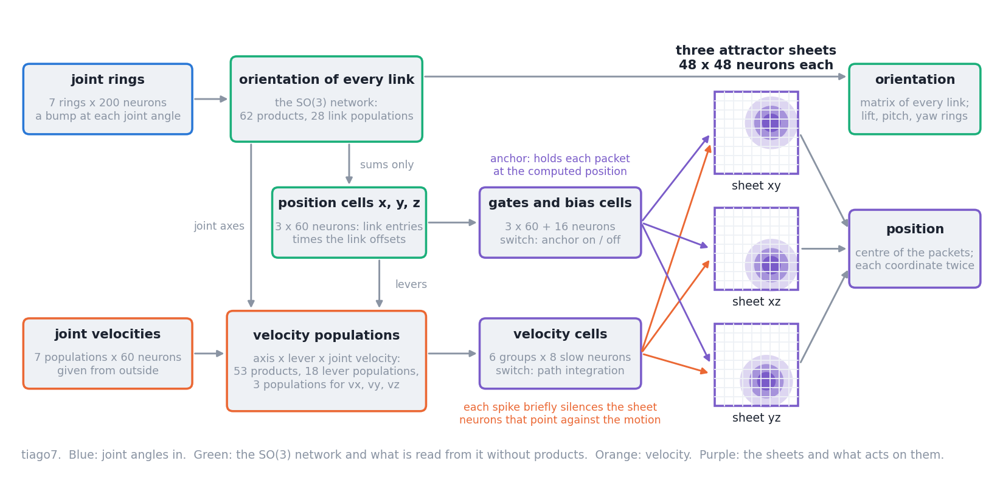
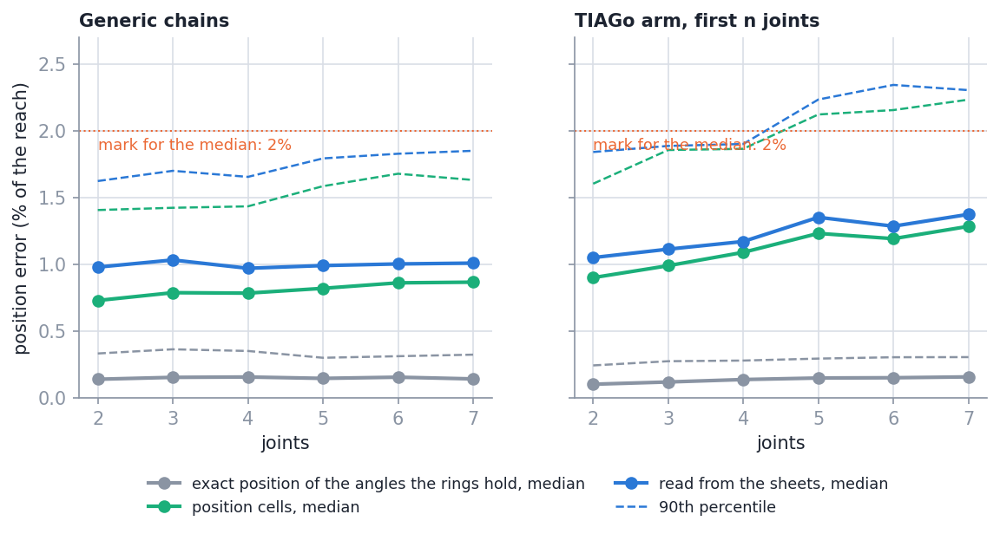
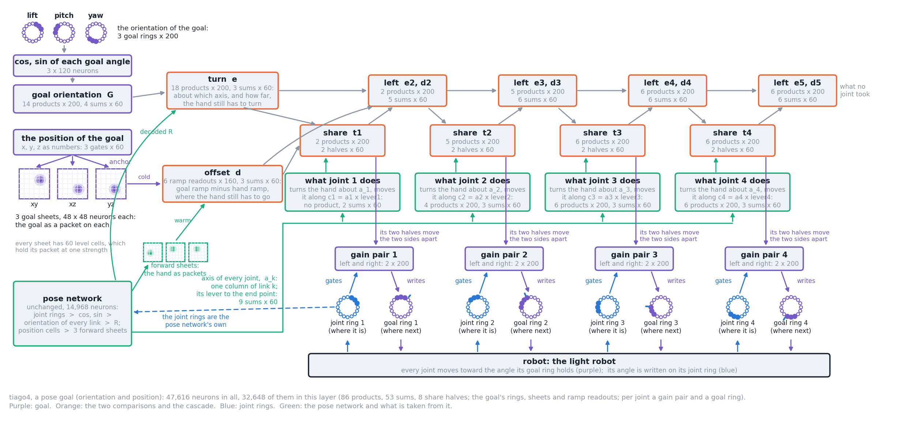
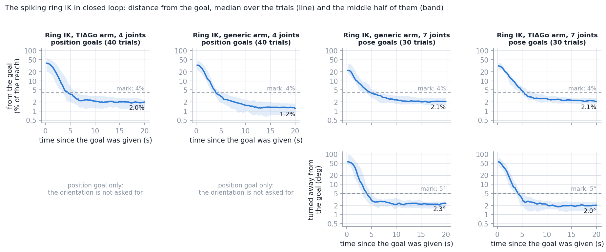

# Ring-Attractor-SE-3-Joint-Architecture

The pose of a robot arm's end point, position and orientation, read from ring attractors
that hold the joint angles. The orientation comes from the network of the SO-3 repo; this
repo adds the position, held as packets of activity on three attractor sheets in the manner
of RatSLAM's pose cells. Spiking neurons in NEST, 2 to 7 joints, the TIAGo arm among them,
with a simulator in which you move the arm and watch the decoded pose next to the true one.

On top of it sits an inverse kinematics made of the same spiking parts: the hand is given a
pose goal, on goal rings and goal sheets, and the arm goes there in closed loop, on a light
robot or on the TIAGo in Gazebo (section 11).

Start here. Details: [`docs/architecture.md`](docs/architecture.md) (how it works),
[`docs/tests.md`](docs/tests.md) (what was tested and the pass marks),
[`docs/results.md`](docs/results.md) (what came out),
[`docs/future-ik.md`](docs/future-ik.md) (ideas for inverse kinematics, and which are built).
The mathematics and derivations of every part: [`TECHNICAL.md`](TECHNICAL.md).

Inverse kinematics: [`docs/ik/README.md`](docs/ik/README.md) (how to give the demonstration),
[`docs/ik/architecture.md`](docs/ik/architecture.md) (what is built),
[`docs/ik/tests.md`](docs/ik/tests.md) (the tests and their marks),
[`docs/ik/results.md`](docs/ik/results.md) (what came out).

Related repos: `Ring-Attractor-SO-2-Joint-Architecture` (one ring per joint, the joint
controller, the paper draft) and `Ring-Attractor-SO-3-Joint-Architecture` (orientation from
the rings). This repo runs on its own: it carries a copy of the SO-3 package (`ring_so3/`).

## 1. What this is and what was measured



- **In:** one ring attractor per joint with a bump at the joint angle, and the joint
  velocities.
- **Orientation:** the SO(3) network, unchanged.
- **Position:** every link's orientation times its fixed offset, summed (no product), held
  by three *position cells*; these anchor one packet on each of three sheets of 48 x 48
  spiking neurons (planes xy, xz, yz). The position is read from the packets.
- **Velocity:** joint axis times lever times joint velocity gives the end point's velocity;
  *velocity cells* move the packets with it when the anchor is off.
- **Weights:** fitted once per kind of population to its measured response. No pose of any
  chain is used for fitting.

### What was tested, and the result

Position error is the distance between the decoded and the true end point, as a share of
the arm's reach (0.806 m for the 7-joint TIAGo arm), given as median / 90th percentile /
largest. Everything runs in NEST with a light robot (joint angles that move toward a target
at a speed limit). Full account: [`docs/results.md`](docs/results.md).

| Test | What was done | Result |
| --- | --- | --- |
| Maths | position as a weighted sum of link orientations, velocity from joint velocities, for 12 chains | equal to the exact kinematics |
| Parts | an anchored sheet; a free packet; a packet moved by a known velocity | an anchored packet sits within 0.56 cells of its place (mark 1 cell). A free packet moves at 0.66 to 1.71 times the speed asked for (mark: within 10%: **missed**) |
| **Held poses** | 300 random poses for each of 12 models (2 to 7 joints): move there, rest 1 s | position off by 0.97% to 1.37% of the reach in the median, largest 90th percentile 2.34%; the 7-joint TIAGo arm 11.1 mm / 18.6 mm / 32.8 mm. All 12 models within the mark set beforehand (median at most 2%, 90th percentile at most 4%). Orientation as in the SO-3 repo (largest median 1.12°) |
| Sheets against position cells | the same poses, position read before and after the sheets | the position cells alone are slightly closer (7 joints: 1.28% against 1.37%): the sheets hold the position, they do not sharpen it |
| **Moving arm** | the arm keeps going from goal to goal at 0.25, 0.5 and 1.0 rad/s | 0.21 to 0.23 s behind at 0.5 rad/s (mark 0.5 s); 5.25% to 7.40% of the reach off while moving. With the anchor given the position 0.2 s ahead: 2.28% (7 joints) |
| **Without the anchor, arm at rest** | anchor off for 2, 5, 10 s | in 29 of 30 gaps all three packets stay alive (in one, a sheet lost its packet); they move 4.59% of the reach in the median in 10 s (mark 2%: **missed**). Anchor on again: readout back in 0.10 s in the median, later than 0.5 s in 15 of 190 gaps (**missed** narrowly) |
| **Without the anchor, arm moving** | path integration alone for 2 to 10 s | **does not work well**: a clear gain in one condition (3 joints, 0.25 rad/s, 2 s: error 0.52 of the distance travelled against 1.21 without); little gain or harm in the others |
| Robustness | 100 poses, 4 and 7 joints | 20% of the sheets' neurons off: 1.93% (7 joints, as built 1.32%). Not robust to a noise current of 150 pA (6.31%) or to losing 5% of the SO(3) product neurons (7.21%) |



## 2. Setup

Everything runs in the Docker image of the SO-2 repo (NEST, Python 3.8, NumPy, SciPy,
Matplotlib, ffmpeg; pinned in `docker/image.env`). Nothing is installed on the host.

**Every command on this page can be pasted into a terminal at the root of this repo as it
stands.** Each one starts a fresh container (no network), runs, and removes the container.

- `docker/run.bash nest --out /tmp/ring-se3 -- '...'` runs what is between the quotes in
  the container. Results that a command writes to `/out/...` appear on the host in
  `/tmp/ring-se3/`.
- `docker/run.bash sim -- '...'` is the same with port 8765 published on localhost (the
  simulator).
- The repo is mounted read-write at `/work`. NEST uses `--threads` threads per run.

## 3. Run it

### 3.1 Calibration

All four calibration files of the default design are checked in (`artifacts/`), so nothing
has to be done. They are written by

```bash
docker/run.bash nest --out /tmp/ring-se3 -- 'python3 -B scripts/calibrate.py --out /out/so3.npz'   # the SO(3) readouts, about a minute
docker/run.bash nest --out /tmp/ring-se3 -- 'python3 -B scripts/calibrate_pose.py --out /out/pose.npz'   # anchor readout and packet speed curve, about two minutes
docker/run.bash nest --out /tmp/ring-se3 -- 'python3 -B scripts/calibrate_ik.py --out /out/ik.npz'   # inverse kinematics: the readouts of the share halves, about a minute
docker/run.bash nest --out /tmp/ring-se3 -- 'python3 -B scripts/calibrate_ramp.py --out /out/ramp.npz'   # inverse kinematics: the ramp readout of the sheets, about seven minutes
```

Without `--out` they write into `artifacts/` and replace the files there. Do that only for
a design that has none yet (`--sheet 32`, `--seed 2`): the recorded results belong to the
files that are checked in.

### 3.2 Held poses of one model

```bash
docker/run.bash nest --out /tmp/ring-se3 -- 'python3 -B scripts/run_static.py --chain tiago4 --poses 20 --out /out/tiago4.json'
```

The arm moves to each random pose and rests 1 s; position and orientation read over the
last 0.5 s are compared with the exact kinematics. Models: `generic2` .. `generic7`,
`tiago2` .. `tiago7`. The summary is printed every 50 poses; every pose is in the JSON
file ([`docs/results/data/README.md`](docs/results/data/README.md) explains the fields).
Without `--poses` it runs the 300 poses of the test.

### 3.3 A moving arm

```bash
docker/run.bash nest --out /tmp/ring-se3 -- 'python3 -B scripts/run_tracking.py --chain tiago4 --speed 0.5 --goals 5 --out /out/tracking.json'
```

The arm keeps moving from one random goal to the next; every 50 ms tick is logged.

### 3.4 Without the anchor

```bash
docker/run.bash nest --out /tmp/ring-se3 -- 'python3 -B scripts/run_dropout.py --chain generic3 --speed 0 --gaps 5 --repeats 2 --out /out/rest.json'
docker/run.bash nest --out /tmp/ring-se3 -- 'python3 -B scripts/run_dropout.py --chain generic3 --speed 0.25 --gaps 2 --repeats 2 --out /out/moving.json'
```

The anchor is switched off for the given number of seconds and on again. `--speed 0`: the
arm rests during the gap (does the packet stay?). Otherwise it keeps moving (does path
integration carry the packet?).

### 3.5 Options

Of `run_static.py`, `run_tracking.py` and `run_dropout.py`:

| Option | Effect |
| --- | --- |
| `--no-path-integration` | the velocity cells are silent: nothing moves the packets but the anchor |
| `--anchor-lead S` | the sheets are anchored at position + velocity x S seconds |
| `--no-velocity` | build no velocity path at all (a smaller network, anchored sheets only) |
| `--sheet N` | sheets of N x N neurons (needs its pose calibration) |
| `--design-seed N` | other thresholds and maximum rates in the populations (needs both calibrations) |
| `--noise PA` | a noise current into every neuron between the rings and the sheets |
| `--silence-sheets 0.1` | switch off this share of the sheets' neurons (`run_static.py`) |
| `--silence 0.05` | switch off this share of the SO(3) product neurons (`run_static.py`) |
| `--lead` | write each joint's angle ahead by the SO(3) readout's delay (`run_tracking.py`) |

### 3.6 The parts, the shift-register experiment, speed

```bash
docker/run.bash nest --out /tmp/ring-se3 -- 'python3 -B scripts/run_parts.py --quick --out /out/parts.json'
docker/run.bash nest --out /tmp/ring-se3 -- 'python3 -B scripts/run_trail.py --chain generic3 --mode trail --repeats 3 --out /out/trail.json'
docker/run.bash nest --out /tmp/ring-se3 -- 'python3 -B scripts/rate_study.py --out /out/rate.json'
docker/run.bash nest --out /tmp/ring-se3 -- 'python3 -B scripts/benchmark.py --models generic3 --threads 8 --seconds 10 --out /out/speed.json'
```

`run_parts.py` measures a sheet and the velocity path on their own (test 3; without
`--quick` the full set). `run_trail.py`: for 2 s the network gets neither the anchor nor the
joint velocities, and the velocity cells are given the velocity that the last 0.5 s of
decoded positions show (`--mode none` and `--mode velocity` are the two comparisons).
`rate_study.py` needs no NEST.

### 3.7 Everything, and the report

```bash
docker/run.bash nest --out /tmp/ring-se3 -- 'python3 -B scripts/run_experiments.py --list'
docker/run.bash nest --out /tmp/ring-se3 -- 'python3 -B scripts/run_experiments.py --jobs 3 --threads 8 --only static --models tiago7 generic7 generic6'
docker/run.bash nest --out /tmp/ring-se3 -- 'python3 -B scripts/report.py'
docker/run.bash nest --out /tmp/ring-se3 -- 'python3 -B scripts/check_doc_numbers.py'
```

`run_experiments.py --list` prints every run of the results; a run whose output exists is
skipped. All of it is several hours on 24 hardware threads; start it in parts (`--only`,
`--models`), as above. `report.py` writes [`docs/results/tables.md`](docs/results/tables.md)
and `docs/results/figures/`. The last command fails if a document quotes a number that is
not in the tables.

## 4. The simulator

```bash
docker/run.bash sim -- 'python3 -B scripts/simulator.py --chain tiago4'
```

Then open <http://localhost:8765/>. The spiking network runs live, one 50 ms tick at a
time, in step with a light robot (joint angles that move toward their targets at a speed
limit; no dynamics).

- **Sliders**: one per joint, within its limits. **Keep moving to random goals**: the arm
  goes from goal to goal by itself. **One random pose**, the **joint speed limit**, a
  **chain** selector.
- **Anchor** and **Path integration** switches. Anchor off, arm at rest: the packets stay.
  Anchor off, arm moving: the packets are carried by the velocity, roughly; with path
  integration off as well they stay where they were. Anchor on: they jump back.
- **The arm in 3D** with the true end point (dot) and the one read from the sheets
  (circle), and the true and decoded frames at every link; drag to turn the view. Below it
  the position error and the orientation error, now and over the last 10 s.
- **Position** x, y, z over the last 30 s, true and read from the sheets.
- **The three sheets**: spikes of the last tick, the true position (cross) and the centre
  of the packet (circle).
- **Lift, pitch, yaw** and the **spikes** of the joint rings and output rings, as in the
  SO-3 simulator.

The status line says how fast the network runs. A 2- or 3-joint network runs faster than
real time, the 7-joint one at less than half of it; the page then shows the arm in slow
motion. Options: `--port`, `--speed`, `--threads`, `--mode manual`, and `--stub`, which
replaces the network by exact kinematics with a little noise, to try the page where NEST is
not installed (`python3 scripts/simulator.py --stub` needs only NumPy). If your browser or
proxy does not pass event streams, open `http://localhost:8765/?poll`.

## 5. Record a session

```bash
docker/run.bash nest --out /tmp/ring-se3 -- 'python3 -B scripts/record_session.py --chain tiago4 --seconds 20 --gap 8 5 --out /out/tiago4_gap'
```

Runs the goal mode without a browser and writes `tiago4_gap.mp4` (the arm with both end
points, the three sheets, position and position error over time), `.png` (the curves of the
whole session) and `.json` (every tick). `--gap START LENGTH` switches the anchor off for
LENGTH seconds, START seconds into the session. The recordings of the results page are in
`docs/results/videos/`.

## 6. Tests

```bash
docker/run.bash nest --out /tmp/ring-se3 -- 'python3 -B -m unittest discover -s tests'   # about six minutes
```

Covers the maths, the sheet, the copy without spikes, every new part in NEST, a 2-joint
pose end to end with both switches, the simulator's interface, the report, and that the
documents quote only numbers from the generated tables. What each of the ten tests of the
results asks, and its pass mark: [`docs/tests.md`](docs/tests.md). The inverse kinematics
adds its rule and wiring against each other, its spiking parts in NEST, a 3-joint arm
reaching position goals, both robots and the IK simulator on stand-ins:
[`docs/ik/tests.md`](docs/ik/tests.md).

## 7. From Python

```python
import nest
import numpy as np
from ring_se3 import experiments, kinematics

chain, design, network, session = experiments.build(nest, "tiago4", threads=8)   # built once, then kept
session.warm_up()                                       # 1 s: the rings and the packets form
measurement = session.go_to(chain.limits().mean(axis=1) + 0.3)       # move there, rest 1 s
print(measurement.position)                             # end point read from the sheets, m, base frame
print(kinematics.position(chain, session.robot.q))      # the exact one
tick = session.tick()                                   # one more 50 ms tick
print(tick.position, tick.cells_position)               # from the sheets (last two ticks), from the position cells
print(tick.tool_rotation())                             # orientation, as in the SO-3 repo
network.set_anchor(False)                               # the packets are on their own now
```

The same lines are in `scripts/example.py`; run them with

```bash
docker/run.bash nest -- 'python3 -B scripts/example.py'
```

`ring_se3/rate/network.py` is the position and velocity part as firing rates, with no NEST.

## 8. Add a chain

One entry in [`ring_so3/chains.py`](ring_so3/chains.py), as in the SO-3 repo: for each joint
its axis, the fixed rotation and offset of its frame in the previous link, its limits. The
offsets are what the position is made of. Everything else follows: the wiring, the size of
the workspace, the network, the simulator. `tests/test_kinematics.py` checks every chain in
`MODEL_NAMES`.

## 9. Status and limits

Date 2026-10-10, branch `ik-pose` (the forward network: 2026-10-05, branch `fk-pose`).

- **Done:** position and velocity of the end point for any chain of turning joints, three
  attractor sheets with anchor and path integration, 12 models measured, simulator,
  recorded sessions, documents. On top of it the inverse kinematics for a pose (section 11):
  goal rings and goal sheets, level cells and ramp readouts, the cascade over turn and
  offset, closed loop on the light robot and on the TIAGo in Gazebo, IK simulator.
- **What works:** the position of a held pose (about 1% of the reach), the orientation
  beside it, a packet that stays alive without input, re-anchoring, following a moving arm
  with a delay that can be removed; reaching pose goals near the hand in closed loop (93%
  to 100% of the test goals, about 2% of the reach and 2° at the end).
- **A packet can go out** when the anchor is off: seen on one sheet in 1 of 30 gaps with the
  arm at rest and in 31 of 160 with the arm moving. The other two sheets still give the
  position, and the packet returns with the anchor.
- **What does not work well:** path integration. A packet's speed for a given velocity
  varies by tens of percent from run to run, so the packets cannot be carried far without
  the anchor ([`docs/results.md`](docs/results.md), sections 2 and 8). What would have to
  change is a sheet whose packet has many more neurons or fires faster, so that a push is
  not a matter of a few spikes.
- **Three pass marks of the forward network missed:** packet speed proportional to the
  velocity; a packet at rest within 2% of the reach for 10 s; readout back within 0.5 s in
  every gap ([`docs/results/tables.md`](docs/results/tables.md), section 12). **One of the
  inverse kinematics:** the path of the 7-joint generic arm
  ([`docs/ik/results/tables.md`](docs/ik/results/tables.md), section 0).
- **Inverse kinematics, limits:** goals far from the hand are often missed, by the rule
  itself; the hand ends no closer than the forward network reads its own pose; the arm's
  geometry is wired in, nothing is learned; no real robot
  ([`docs/ik/results.md`](docs/ik/results.md), section 11).
- **Simulation only.** The light robot, and the TIAGo in Gazebo for the inverse kinematics.
  No real robot.
- **Slow for long arms:** the 7-joint network runs at 0.44 of real time on 8 threads, with
  the IK layer at 0.22 on 12.
- **Inherited from the SO(3) network:** its delay of about 0.2 s, and its weakness to
  losing product neurons.
- **The resting drive of the velocity cells and the two switches are set from outside**
  ([`docs/architecture.md`](docs/architecture.md), section 8).
- **Next:** the same loop with kinematics learned from the arm's own motion
  ([`docs/ik/results.md`](docs/ik/results.md), section 11).

## 10. Where things are

Paths are relative to the repo root.

| Topic | Code | Document | Data |
| --- | --- | --- | --- |
| Chains, workspace, exact position and velocity | `ring_se3/chains.py`, `ring_se3/kinematics.py` | [`docs/architecture.md`](docs/architecture.md) section 2 | |
| Position and velocity as sums and products | `ring_se3/wiring.py` | section 2 | |
| The sheet: weights, anchor, labels, readout | `ring_se3/sheet.py`, `ring_se3/nest/sheet.py` | section 4 | |
| The pose network | `ring_se3/nest/network.py` | sections 3, 7 | |
| Calibration | `ring_se3/nest/calibrate.py`, `scripts/calibrate_pose.py`, `scripts/calibrate.py` | section 6 | `artifacts/` |
| Copy without spikes | `ring_se3/rate/network.py`, `scripts/rate_study.py` | [`docs/tests.md`](docs/tests.md) test 2 | `docs/results/data/rate_study.json` |
| Parts on their own | `ring_se3/nest/rigs.py`, `scripts/run_parts.py` | test 3 | `docs/results/data/parts.json` |
| Held poses | `ring_se3/session.py`, `ring_se3/experiments.py`, `scripts/run_static.py` | tests 4, 5, 6, 10 | `docs/results/data/static/` |
| Moving arm | `scripts/run_tracking.py` | test 7 | `docs/results/data/tracking/`, `tracking_variants/` |
| Without the anchor | `scripts/run_dropout.py` | test 8 | `docs/results/data/dropout/` |
| Shift-register experiment | `scripts/run_trail.py` | [`docs/architecture.md`](docs/architecture.md) section 5 | `docs/results/data/trail/` |
| Variants and robustness | `scripts/run_static.py` with options | test 9 | `docs/results/data/robust/` |
| All runs, speed | `scripts/run_experiments.py`, `scripts/benchmark.py` | | `docs/results/data/speed.json` |
| Tables and figures | `scripts/report.py`, `scripts/check_doc_numbers.py` | [`docs/results.md`](docs/results.md) | [`docs/results/tables.md`](docs/results/tables.md), `docs/results/figures/` |
| Simulator and recordings | `ring_se3/sim/`, `scripts/simulator.py`, `scripts/record_session.py` | this file, sections 4 and 5 | `docs/results/videos/` |
| Architecture figure | `scripts/draw_architecture.py` | | `docs/figures/architecture.png` |
| The SO(3) network (copied) | `ring_so3/` | [`docs/architecture.md`](docs/architecture.md) section 9 | |
| Ideas for inverse kinematics, and which are built | | [`docs/future-ik.md`](docs/future-ik.md) | |
| IK: the rule without neurons, standard methods | `ring_se3/ik/rules.py`, `ring_se3/ik/design.py`, `ring_se3/standard/ik.py`, `scripts/ik_study.py` | [`TECHNICAL.md`](TECHNICAL.md) sections 14 to 19, 28 | `docs/ik/results/data/study.json` |
| IK: the rule as products and sums | `ring_se3/ik/wiring.py` | [`TECHNICAL.md`](TECHNICAL.md) sections 23, 24 | |
| IK: level cells, ramp readout, the network | `ring_se3/nest/sheet.py`, `ring_se3/nest/ik_calibrate.py`, `ring_se3/nest/ik_network.py`, `scripts/calibrate_ramp.py`, `scripts/run_ik_sheets.py` | [`docs/ik/architecture.md`](docs/ik/architecture.md); [`TECHNICAL.md`](TECHNICAL.md) sections 20 to 22 | `artifacts/`, `docs/ik/results/data/sheets.json` |
| IK: closed loop and its tests | `ring_se3/ik/session.py`, `ring_se3/ik/experiments.py`, `scripts/run_ik_parts.py`, `scripts/run_ik_reach.py`, `scripts/run_ik_experiments.py` | [`docs/ik/tests.md`](docs/ik/tests.md) | [`docs/ik/results/data/`](docs/ik/results/data/README.md) |
| IK: Gazebo as the robot | `ring_so3/robots.py`, `ring_so3/gazebo/link.py`, `ring_se3/gazebo/link.py`, `gazebo/ring_ik.world`, `scripts/run_ik_gazebo.py` | [`docs/ik/README.md`](docs/ik/README.md) section 6 | |
| IK: simulator | `ring_se3/sim/ik_server.py`, `ring_se3/sim/ik_page.py`, `scripts/ik_simulator.py` | [`docs/ik/README.md`](docs/ik/README.md) | |
| IK: tables, figures, spikes, speed | `scripts/ik_report.py`, `scripts/ik_spike_census.py`, `scripts/ik_benchmark.py`, `scripts/draw_ik_architecture.py` | [`docs/ik/results.md`](docs/ik/results.md); [`TECHNICAL.md`](TECHNICAL.md) part III | [`docs/ik/results/tables.md`](docs/ik/results/tables.md), `docs/ik/spikes/`, `docs/ik/figures/` |

## 11. Inverse kinematics for a pose

The hand is given a pose: an orientation on three goal rings (lift, pitch, yaw) and a
position as a packet on three goal sheets. The network compares both with the pose it
decodes, hands each joint its share of the turn and of the offset that are still to make,
joint after joint down the arm, and every joint follows its own goal ring. The loop closes
through the robot: the light robot of this repo, or the TIAGo arm in Gazebo.



What is built: [`docs/ik/architecture.md`](docs/ik/architecture.md). The mathematics, the
derivations, and how every part runs as spikes: [`TECHNICAL.md`](TECHNICAL.md), parts II and
III. The tests and their marks: [`docs/ik/tests.md`](docs/ik/tests.md). What came out:
[`docs/ik/results.md`](docs/ik/results.md).

### What was tested, and the result

Everything in this table is the spiking network ("ring IK"). `tiago4`, `tiago7`, `generic4`
and `generic7` are the arms it was built for, not names of the method. A goal is reached when
the hand ends within 4% of the reach and, for a pose, within 5° of it. Marks were fixed
before the test pairs ran. Full account: [`docs/ik/results.md`](docs/ik/results.md).

| Test | What was done | Result |
| --- | --- | --- |
| The rule, exact arithmetic | 60 pairs per arm; what a share is divided by, cascade or not, balance, gain | the cascade with a constant divisor reaches 95% to 100% of the goals; every joint getting the whole error 78% to 98% |
| The sheets | three sheets alone at 80 places, without and with level cells | without: 33 of 240 packets weak, ramp readout off by 6.26% of the reach. With: none weak, 0.59% |
| Comparisons and shares in spikes | arm held, 40 to 60 poses per arm | offset within 1.74% of the reach (mark 2%), direction of the turn within 4.6° (mark 10°), every share above 0.05 rad with the right sign |
| **Reaching, 4 joints, position** | 40 test pairs per arm, light robot | 98% (`tiago4`) and 100% (`generic4`) reached; 1.96% and 1.24% of the reach at the end; within the marks after 4.5 s and 4.0 s |
| **Reaching, 7 joints, pose** | 30 test pairs per arm, light robot | 97% (`generic7`) and 93% (`tiago7`) reached; 2.02% and 2.09% of the reach, 2.27° and 1.89° at the end; after 5.0 s and 5.7 s. Path 1.54 times the straight line for `generic7` (mark 1.5: **missed**) |
| Sheets or numbers | the same pairs with positions compared as numbers | numbers are a little closer: 1.62% against 1.96% (4 joints), 1.70% against 2.09% (7 joints) |
| Without the cascade | `tiago4`, every joint gets the whole error | 88% reached, after 8.1 s |
| Disturbances | `tiago4`, 20 pairs each | robot 30% weak or strong, a joint pushed: 95% to 100% reached. Goal changed on the way: 80%. Goals anywhere: 70% |
| **TIAGo in Gazebo** | the arm's own controller and gravity; 30 pose pairs, 20 position pairs | 93% of the pose goals (all 28 of those reached on the light robot) and 100% of the position goals; 2.22% of the reach and 1.50° at the end. Damped least squares with exact joint angles: 100%, 0.29%, 0.35° |



Limits: goals near the start pose only; the hand ends no closer than the forward network
reads its own pose; the arm's geometry is wired in; 0.22 of real time for seven joints.

### 11.1 The IK simulator

```bash
docker/run.bash sim -- 'python3 -B scripts/ik_simulator.py --chain tiago4'
```

Then open <http://localhost:8765/> and press **Random goal nearby**.
[`docs/ik/README.md`](docs/ik/README.md) walks through a demonstration step by step.

- **The goal** is drawn in the 3D view: drag its dot to move it, an arrow tip to move it
  along one axis, a ring to turn it. Six sliders do the same.
- **Task**: pose, position only, orientation only. `tiago4` starts with the position (four
  joints); `--chain tiago7` or `generic7` starts with the pose.
- **Method**: ring IK (the spiking network); the exact cascade; damped least squares;
  Jacobian transpose. **Same start and goal, next method** puts the arm back and repeats the
  goal; the chart overlays the last six runs.
- **The sheets**: the goal's packets and the hand's packets in the three planes, and goal
  minus hand as the network holds it. **Goal anchor** off: the goal sheets keep the goal by
  themselves.
- Below: every joint's share and the lead of its goal ring, and the spikes of all rings.

`--stub` replaces the network by the exact rule (`python3 scripts/ik_simulator.py --stub`
needs only NumPy). Other options: `--task`, `--position-goal`, `--method`, `--port`,
`--threads`.

### 11.2 With the TIAGo in Gazebo as the robot

Paste the three steps one at a time, each in a terminal at the root of this repo.

```bash
docker/run.bash gazebo up ik-gazebo --gpu
```

Starts Gazebo with the TIAGo in a world with nothing but the ground, a light and a camera,
in the background; returns after about a minute with "Gazebo ready".

```bash
docker/run.bash gazebo exec ik-gazebo -- 'python3 -B scripts/ik_simulator.py --chain tiago7 --gazebo'
```

The simulator beside it, in the foreground. Open <http://localhost:8765/>; the robot
selector says "TIAGo in Gazebo" and a panel shows the camera picture. Ctrl-C ends it.

```bash
docker/run.bash gazebo down ik-gazebo
```

Stops Gazebo. Without an NVIDIA GPU or a desktop session leave `--gpu` out: everything works
except the camera picture. More, and what to do if something is in the way:
[`docs/ik/README.md`](docs/ik/README.md), section 6.

### 11.3 The measurements

```bash
docker/run.bash nest --out /tmp/ring-se3 -- 'python3 -B scripts/ik_study.py --out /out/study.json'                                   # the rule with exact kinematics, 7 minutes
docker/run.bash nest --out /tmp/ring-se3 -- 'python3 -B scripts/run_ik_sheets.py --out /out/sheets.json'                             # level cells and ramp readout on sheets alone, 8 minutes
docker/run.bash nest --out /tmp/ring-se3 -- 'python3 -B scripts/run_ik_parts.py --chain tiago4 --poses 20 --out /out/parts_try.json'   # comparison and shares in spikes, 6 minutes
docker/run.bash nest --out /tmp/ring-se3 -- 'python3 -B scripts/run_ik_reach.py --chain tiago4 --pairs 3 --out /out/reach_try.json'    # three closed-loop trials, 3 minutes
```

All runs of the results, in batches that stay under two hours (a run that its time guard
cut is finished by starting the same batch again):

```bash
docker/run.bash nest -- 'python3 -B scripts/run_ik_experiments.py --list'
docker/run.bash nest -- 'python3 -B scripts/run_ik_experiments.py --batch parts reach_position --jobs 4 --threads 6 --max-minutes 105'
docker/run.bash nest -- 'python3 -B scripts/ik_report.py'
docker/run.bash nest -- 'python3 -B scripts/check_doc_numbers.py'
```

Batches: `study`, `parts`, `reach_position`, `reach_pose`, `variants`, `disturbances`.
`ik_report.py` writes [`docs/ik/results/tables.md`](docs/ik/results/tables.md) and
`docs/ik/results/figures/`.

In Gazebo (start it as in 11.2, with `--out /tmp/ring-se3` so that results land there; no
`--gpu` needed), then stop it with `docker/run.bash gazebo down ik-gazebo`:

```bash
docker/run.bash gazebo up ik-gazebo --out /tmp/ring-se3
```

```bash
docker/run.bash gazebo exec ik-gazebo -- 'python3 -B scripts/run_ik_gazebo.py --check 5 --out /out/gazebo_kinematics.json'
docker/run.bash gazebo exec ik-gazebo -- 'python3 -B scripts/run_ik_gazebo.py --chain tiago4 --pairs 3 --out /out/gazebo_try.json'
```

Spike counts, weights and the level-cell figure of `TECHNICAL.md` part III, the speed on an
idle machine, and the architecture drawings:

```bash
docker/run.bash nest -- 'python3 -B scripts/ik_spike_census.py'
docker/run.bash nest --out /tmp/ring-se3 -- 'python3 -B scripts/ik_benchmark.py --out /out/speed.json'
docker/run.bash nest --out /tmp/ring-se3 -- 'python3 -B scripts/draw_ik_architecture.py --chain generic7 --out /out/ik_generic7.png'
```

### 11.4 From Python

```bash
docker/run.bash nest -- 'python3 -B scripts/ik_example.py'
```

`scripts/ik_example.py` builds the network for the 4-joint TIAGo arm, gives the hand one
position goal and prints the distance from it every half second; it is the shortest way
into the code. Its core:

```python
import nest
from ring_se3 import kinematics
from ring_se3.ik import experiments
from ring_se3.ik.session import PoseIkSession

chain, network = experiments.build_ik(nest, "tiago4", threads=8)     # pose network and IK layer; calibrations from artifacts/
session = PoseIkSession(network, chain.limits().mean(axis=1))        # the light robot at a start pose
session.warm_up()                                                    # 1 s: rings and packets form; the goal sits on the hand
goal_position = kinematics.position(chain, session.q + 0.3)          # the pose of a joint pose nearby: it can be reached
trial = session.reach([0.0, 0.0, 0.0], goal_position)                # lift, pitch, yaw are not asked of a 4-joint arm
print(trial.final_error_reach, trial.reached(network.ik_design))     # distance at the end, as a share of the reach
```
