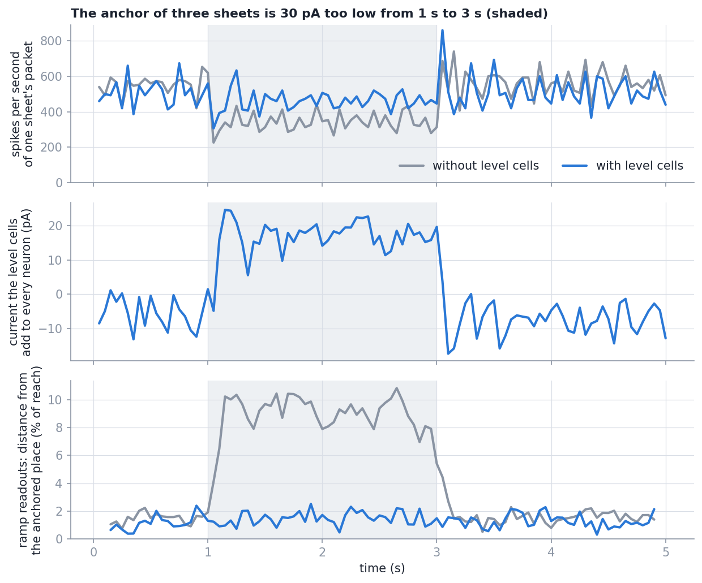

# Technical reference: the pose of the arm from joint rings (SE(3))

The mathematics behind every part that this repo adds, with the derivations. How to run
things is in [`README.md`](README.md); which part is which file is in
[`docs/architecture.md`](docs/architecture.md); what was measured is in
[`docs/results.md`](docs/results.md).

Three parts:

- **Part I** (sections 1 to 13): the pose of the end point from the joint rings. Position
  as a weighted sum, the attractor sheets, the anchor, path integration.
- **Part II** (sections 14 to 30): inverse kinematics for a pose. The two comparisons, the
  cascade over turn and offset and its derivation, how a packet on a sheet becomes a number,
  the level cells, the closed loop. Files: [`docs/ik/architecture.md`](docs/ik/architecture.md);
  measurements: [`docs/ik/results.md`](docs/ik/results.md).
- **Part III** (sections 31 to 38): how the computations of part II exist in the network as
  spikes, with measured spike counts and weights.

This page builds on two others and does not repeat them:

- the ring attractor, its neuron and its synapses:
  `Ring-Attractor-SO-2-Joint-Architecture/TECHNICAL.md`, sections 2 to 6;
- the orientation of every link, populations that hold a value, readouts, the population
  that multiplies: `Ring-Attractor-SO-3-Joint-Architecture/TECHNICAL.md`, sections 2 to 12.

Two kinds of statement are kept apart: **Built** (what the code does, with its file) and
**Model** (a few equations that explain why it behaves so).

## Contents

1. [The task](#1-the-task)
2. [The position is a weighted sum](#2-the-position-is-a-weighted-sum)
3. [The velocity of the end point](#3-the-velocity-of-the-end-point)
4. [Scaling: what the populations hold](#4-scaling-what-the-populations-hold)
5. [The attractor sheet](#5-the-attractor-sheet)
6. [The anchor](#6-the-anchor)
7. [Switching the anchor](#7-switching-the-anchor)
8. [Path integration](#8-path-integration)
9. [Reading the position](#9-reading-the-position)
10. [A moving arm: why velocity does not remove the delay, and what does](#10-a-moving-arm-why-velocity-does-not-remove-the-delay-and-what-does)
11. [Why path integration is crude here](#11-why-path-integration-is-crude-here)
12. [Measuring](#12-measuring)
13. [Symbols](#13-symbols)

Part II. Inverse kinematics for a pose

14. [The inverse task](#14-the-inverse-task)
15. [Two comparisons: the turn and the offset](#15-two-comparisons-the-turn-and-the-offset)
16. [What one joint does to the hand](#16-what-one-joint-does-to-the-hand)
17. [The cascade over turn and offset](#17-the-cascade-over-turn-and-offset)
18. [Dividing by a constant](#18-dividing-by-a-constant)
19. [The balance between turning and moving](#19-the-balance-between-turning-and-moving)
20. [From a packet to a number: the ramp readout](#20-from-a-packet-to-a-number-the-ramp-readout)
21. [Level cells: a packet of one strength](#21-level-cells-a-packet-of-one-strength)
22. [The goal on sheets](#22-the-goal-on-sheets)
23. [Scaling: what the populations of the layer hold](#23-scaling-what-the-populations-of-the-layer-hold)
24. [The cascade as populations](#24-the-cascade-as-populations)
25. [Closing the loop: gain, delay, and where the hand ends](#25-closing-the-loop-gain-delay-and-where-the-hand-ends)
26. [A goal that travels](#26-a-goal-that-travels)
27. [Where the rule stops short](#27-where-the-rule-stops-short)
28. [The standard methods beside it](#28-the-standard-methods-beside-it)
29. [Measuring](#29-measuring)
30. [Symbols of part II](#30-symbols-of-part-ii)

Part III. In spikes

31. [Three kinds of signal in one network](#31-three-kinds-of-signal-in-one-network)
32. [Who fires, and how often](#32-who-fires-and-how-often)
33. [The goal's position becomes a packet](#33-the-goals-position-becomes-a-packet)
34. [A packet becomes a number](#34-a-packet-becomes-a-number)
35. [Level cells, spike by spike](#35-level-cells-spike-by-spike)
36. [The offset, the direction, and a share](#36-the-offset-the-direction-and-a-share)
37. [From the mathematics to the spikes: one table](#37-from-the-mathematics-to-the-spikes-one-table)
38. [Where these numbers come from](#38-where-these-numbers-come-from)

## 1. The task

The pose of the end point is an element of SE(3): a rotation and a translation,

```math
T = \begin{pmatrix} R_{ee} & p \\ 0 & 1 \end{pmatrix}, \qquad R_{ee} \in SO(3),\; p \in \mathbb{R}^3 .
```

The SO(3) network gives $R_k$ for every link $k$ from the joint rings. This repo adds $p$,
and holds it on attractor sheets.

The chain: joint $k$ sits in link $k-1$ at the fixed offset $o_k$ (a vector in that link's
frame) and turns about one axis of its own frame; the end point sits in link $n$ at
$o_{n+1}$. $R_0 = I$.

## 2. The position is a weighted sum

**Derivation.** The origin $c_k$ of joint $k$ is reached from the origin of joint $k-1$ by
going the offset $o_k$, which is given in the frame of link $k-1$, so it has to be turned by
that link's orientation:

```math
c_k = c_{k-1} + R_{k-1}\, o_k, \qquad c_0 = 0 .
```

Unrolling,

```math
c_k = \sum_{m=0}^{k-1} R_m\, o_{m+1}, \qquad
p = c_{n+1} = \sum_{m=0}^{n} R_m\, o_{m+1} .
```

Written by components, $p_i = \sum_m \sum_j (R_m)_{ij}\,(o_{m+1})_j$: every coordinate of the
position is a sum of matrix entries of the links, each multiplied by a **constant** (a link
offset). The SO(3) network already holds every $(R_m)_{ij}$. So the position needs **no
product**: one population per coordinate that sums what is there, with the offsets as
weights (SO-3 reference, section 7).

The first term, $R_0 o_1 = o_1$, is a constant: the origin of the first joint. It is the
centre of the workspace (section 4).

**The lever of joint $k$** is the vector from the joint's origin to the end point:

```math
l_k = p - c_k = \sum_{m=k}^{n} R_m\, o_{m+1} ,
```

also a weighted sum, and $l_1 = p - o_1$.

`ring_se3/kinematics.py` is the exact version, `ring_se3/wiring.py` the list of sums;
`tests/test_kinematics.py` checks them against each other to $10^{-9}$.

## 3. The velocity of the end point

**Derivation.** Hold all joints but joint $k$ still. Everything beyond joint $k$ is then one
rigid body turning about the axis $a_k$ (a unit vector in the base frame) through the point
$c_k$, at the angular speed $\dot q_k$. A point $x$ of a rigid body turning with angular
velocity $\omega$ about a point $c$ moves with $\omega \times (x - c)$. For the end point,

```math
\frac{\partial p}{\partial q_k}\,\dot q_k = \dot q_k\; a_k \times (p - c_k) = \dot q_k\; a_k \times l_k .
```

The position depends on all joints, and the chain rule adds the contributions:

```math
v = \dot p = \sum_{k=1}^{n} \dot q_k\; \big(a_k \times l_k\big) = J(q)\,\dot q, \qquad
J_{\cdot k} = a_k \times l_k .
```

$J$ is the position Jacobian. Its column $k$ says in which direction and how far the end
point moves per radian of joint $k$.

**What it costs.** $a_k$ is a column of $R_k$ (SO-3 reference, section 3) and $l_k$ a sum
(section 2); both exist. New are the products:

```math
w_k = \dot q_k\, a_k \;\;(3\ \text{products}), \qquad
(w_k \times l_k)_i = w_{k,j}\, l_{k,m} - w_{k,m}\, l_{k,j} \;\;(2\ \text{products per component, 6 in all}),
```

nine per joint, with $(i, j, m)$ a cyclic order of $(x, y, z)$. Joint 1 of the chains here
turns about a fixed axis, so its $w_1$ is a constant times $\dot q_1$ and costs nothing: 8,
17, 26, 35, 44, 53 products for 2 to 7 joints. The check against finite differences,
$J_{\cdot k} \approx [p(q + h e_k) - p(q - h e_k)]/2h$, is in the tests.

**The same products serve inverse kinematics.** $J^\top e$ for a position error $e$ is
$(a_k \times l_k)\cdot e$ per joint: section 16 builds on it.

## 4. Scaling: what the populations hold

A population holds numbers in $[-1, 1]$, so every quantity is divided by a bound.

| Quantity | Held as | Bound |
| --- | --- | --- |
| position | $u = (p - o_1)/L$ | reach $L = \sum_{m\ge1} \lVert o_{m+1} \rVert$: the summed link lengths after the first joint |
| lever of joint $k \ge 2$ | $l_k / L_k$ | $L_k = \sum_{m \ge k} \lVert o_{m+1} \rVert$ |
| joint velocity | $\dot q_k / \dot q_{\text{ref}}$ | $\dot q_{\text{ref}} = 1$ rad/s (clipped beyond) |
| end-point velocity | $\hat v = v / (L\,\dot q_{\text{ref}}\,\nu)$ | $\nu = 1.5$ |

*Why the bounds hold.* $\lVert R_m o_{m+1}\rVert = \lVert o_{m+1}\rVert$ because a rotation
preserves length; the triangle inequality gives $\lVert p - o_1\rVert \le L$ and
$\lVert l_k\rVert \le L_k$. Every component of a unit vector $a_k$ is at most 1.

With these, section 3 reads

```math
\hat v = \sum_k \frac{L_k}{L\,\nu}\; \Big(\tfrac{\dot q_k}{\dot q_{\text{ref}}}\, a_k\Big) \times \frac{l_k}{L_k} .
```

For the 7-joint TIAGo arm $L = 0.806$ m, and $\hat v = 1$ is $1.5$ reaches per second.

## 5. The attractor sheet

**Built** (`ring_se3/sheet.py`, `ring_se3/nest/sheet.py`). A sheet is a square of
$n \times n$ neurons ($n = 48$) over one coordinate plane. Neuron $(i, j)$ stands for the
place

```math
c_{ij} = \Big(-E + (i + \tfrac12)\,\delta,\; -E + (j + \tfrac12)\,\delta\Big), \qquad
\delta = \frac{2E}{n} = 0.05, \qquad E = 1.2 ,
```

in scaled coordinates: one *cell* is $\delta = 5\%$ of the reach. $E > 1$ leaves room for a
packet at the edge of the workspace. Three sheets hold the planes $(x, y)$, $(x, z)$,
$(y, z)$.

**Neuron.** The ring neuron of the SO-2 repo, resting exactly at threshold (SO-2 reference,
section 2), as NEST's `iaf_psc_alpha_multisynapse` so that it can have four synapse types:
the ring's excitatory (27 ms) and inhibitory (50 ms) ones, a fast inhibitory one for the
velocity cells (3 ms), and one for the anchor (20 ms).

**Recurrent weights.** The ring's profile $w(d) = 3\,(2e^{-d^2/50} - e^{-d^2/200})$, over the
distance in the plane:

```math
W_{a \to b} = w\big(\lambda\,\lVert c_b - c_a - \kappa\,\delta\, e_a \rVert / \delta\big), \qquad
\lambda = 1.5,\quad \kappa = 3 ,
```

with $\lambda$ the profile's distance units per cell and $e_a$ the unit vector of neuron
$a$'s *label* (below). For $\kappa = 0$ this is the ring's connectivity turned into a disc:
neurons within $6.8/\lambda \approx 4.5$ cells excite each other, a surround inhibits, far
neurons are not connected.

**Model: one packet, anywhere.** As on the ring, neurons inside a group keep each other
firing and silence their surround, and since $W$ depends only on the difference of places
(for $\kappa = 0$), the packet can sit at any place of the plane: a two-dimensional
continuous attractor. Measured: one packet about six cells across, about 25 spikes per
50 ms tick, alive without any input.

**Labels.** Every neuron carries one of four labels, $+a, -a, +b, -b$ for a sheet over the
plane $(a, b)$, in a $2\times2$ tiling. The centre of its *outgoing* weights is moved
$\kappa = 3$ cells along its label ($e_a$ above). Over a packet the four groups are equally
many and their shifts cancel:

```math
\sum_{\text{labels}} e = (1,0) + (-1,0) + (0,1) + (0,-1) = 0 ,
```

so the packet rests. Section 8 breaks that balance on purpose.

## 6. The anchor

The anchor has to pull the packet to a given place $x$ (two scaled coordinates), using only
sums of values that populations hold.

**Built** (`nest/sheet.py: connect_anchor`, `connect_anchor_bias`). The neuron at place $c$
receives the current

```math
I_c(x) = b - \frac{g}{2}\,\lVert c - x \rVert^2 ,
```

a bowl turned upside down with its top $b$ at $x$. Expanding the square,

```math
I_c(x) = \underbrace{g\Big(c \cdot x - \tfrac12 \lVert x \rVert^2\Big)}_{\text{moving part}}
\;+\; \underbrace{\Big(b - \tfrac{g}{2}\lVert c \rVert^2\Big)}_{\text{fixed part}} .
```

- **Moving part.** $c\cdot x - \tfrac12\lVert x\rVert^2 = \sum_{\text{2 coordinates}} \big(c_a x_a - \tfrac12 x_a^2\big)$:
  per coordinate, a weighted sum of $x_a$ and of $x_a^2$. Both are read from one *gate*
  population that holds $x_a$, with two sets of decoders (SO-3 reference, section 6: a
  population's rates can be read as any smooth function of its value, here $x$ and $x^2$).
  The weight from gate neuron $j$ to the sheet neuron at $c$ is
  $g\,(c_a\, d^{(1)}_j - \tfrac12 d^{(2)}_j)/(e\,\tau_{\text{anchor}})$.
- **Fixed part.** The same for every pose: a bias per neuron, delivered by 16 *bias cells*
  that fire at a steady 99 Hz (section 7 says why not as a plain bias current).

No place code is needed on the way in: three numbers go in and a packet comes out. This is
the cosine drive of the SO(3) output rings (SO-3 reference, section 12) done for a plane:
there $x\cos\theta + y\sin\theta$ peaks at the right angle, here $c\cdot x - \tfrac12\lVert c\rVert^2$
peaks at the right place.

**Why the term $-\tfrac12\lVert x\rVert^2$ must be there.** Without it the current would be
$g\,c\cdot x - \tfrac g2\lVert c\rVert^2 + b = b - \tfrac g2\lVert c - x\rVert^2 + \tfrac g2\lVert x\rVert^2$:
still peaked at $x$, but lifted by $\tfrac g2\lVert x\rVert^2$ everywhere. These neurons rest
at threshold, so a positive current makes them fire: a whole disc of radius $\lVert x\rVert$
around $x$ would be driven. With the term the current is at most $b$ and positive only
within $\sqrt{2b/g}$ of $x$.

**Values.** $g = 8$ pA per cell² (3,200 pA per scaled unit²), $b = 32$ pA: the current is
positive within $\sqrt{2\cdot 32/8} \approx 2.8$ cells of $x$, about the size of a packet,
and strongly negative further away. A packet somewhere else is silenced, and a new one
forms at $x$.

**Model: the packet follows like a ball in a bowl.** A packet at $y$ sees a current that
falls off across it with the slope $\nabla I = g\,(x - y)$. The neurons on the side toward
$x$ are driven more, those on the other side less; the packet gains neurons on one side and
loses them on the other, at a speed that grows with the slope:

```math
\dot y = \mu\, g\,(x - y) \quad\Longrightarrow\quad \text{time constant}\;\; \tau_a = \frac{1}{\mu g} .
```

Measured on a sheet alone, with the anchor current set directly and moving at 0.5 units/s:
the packet is 15 ms behind for $g = 8$ and 40 ms for $g = 4$, about inverse to $g$ as the
model says. At rest it sits within 0.14 cells of $x$ in the median.

**An error of the square moves the whole bowl.** If the decoded $x^2$ is off by
$\epsilon$, the current changes by $-\tfrac g2\epsilon$ at *every* neuron: the place of the
peak is untouched, the height is not. With $g = 3{,}200$ pA per unit² and a readout of the
square that is right to 0.015 (root mean square), the height varies by some tens of pA,
comparable to $b$. This is why the position degrades under strong noise
([`docs/results.md`](docs/results.md), section 10) although the packet's place is carried
by the linear part.

## 7. Switching the anchor

Two findings, both by measurement.

**Both parts through one synapse.** The moving part has positive and negative
contributions. Through the ring neuron's own two synapses the negative part would decay
with 50 ms and the positive part with 27 ms: whenever the anchor changes, a net negative
current is left over for some tens of milliseconds and silences the packet. The anchor
therefore has its own synapse type that carries both signs with one time constant (20 ms).

**Both parts through spikes.** The moving part and the fixed part are each thousands of pA
at a neuron far from the centre and cancel to a small sum. If the fixed part were a bias
current switched instantly while the moving part fades with its synapse, the mismatch
during those milliseconds is of that size: the whole sheet fires, then falls silent. With
the fixed part delivered by the bias cells' spikes through the same synapse type, both
parts rise and fall with the same time course and their sum stays within $b$.

Switching the anchor off silences the three gate populations and the bias cells; switching
it on restores their bias currents and sets each of those neurons to a fresh potential
between rest and threshold (a neuron that was held far below rest would otherwise return
late, each at its own time).

## 8. Path integration

With the anchor off, the packet should move with the end point's velocity.

**Built** (`nest/calibrate.py`, `nest/sheet.py: connect_velocity_cells`). For each
coordinate and sign there are 8 *velocity cells*. Each spike of a cell for the direction
$+a$ sends a short, strong inhibition (peak 300 pA, 3 ms) to the sheet neurons labelled
$-a$, in the two sheets that hold coordinate $a$.

**Model: why silencing one group moves the packet.** While the group $-a$ is silent, the
remaining shifts no longer cancel: $\sum e = (+1, 0)$ over the three groups that are left.
The packet's outgoing excitation is centred ahead of it in the direction $+a$, so it moves
that way, at a top speed set by $\kappa$ (measured: about 20 cells per second with the group
silenced all the time). If the group is silenced a fraction $D$ of the time, the mean speed
is about $D$ times that.

**The velocity cell: a rate proportional to its input.** A velocity cell is an
`iaf_psc_alpha` neuron with a very long membrane time constant ($\tau_m = 5$ s,
$C = 250$ pF, $V_{th} = 15$ mV, potential bounded below at rest). From the rate formula
(SO-2 reference, section 2), for $I \gg I_{th} = C V_{th}/\tau_m = 0.75$ pA,

```math
T = \tau_m \ln\frac{I}{I - I_{th}} \approx \tau_m \frac{I_{th}}{I} = \frac{C V_{th}}{I}
\quad\Longrightarrow\quad f \approx \frac{I}{C\,V_{th}} :
```

it integrates its input and fires once per $C V_{th} = 3{,}750$ pA·ms of charge. A current
of 45 pA gives 12 Hz, the *full drive*. An ordinary neuron of the network cannot fire that
slowly in a controlled way; this one turns a value into a pulse rate linearly.

**Push-pull about a resting rate.** Let $S(r)$ be the packet's speed when one group is
pulsed at the rate $r$. Measured, $S$ has a dead zone: below a certain rate the packet does
not move at all (it sticks to the lattice of cells). So all velocity cells get a *resting
drive* $r_0$ (0.19 of the full drive) while the arm moves, and a velocity raises the drive
on one side by $\Delta$ and lowers it on the other:

```math
\text{speed} = S(r_0 + \Delta) - S(r_0 - \Delta) \;\approx\; 2\,S'(r_0)\,\Delta \quad \text{for small } \Delta .
```

Around $r_0$ the response is linear and starts at zero velocity. The price is that the
packet is pulsed from all sides whenever the arm moves, which shakes it. While no joint
moves (all $|\dot q_k| < 0.02$ rad/s) the resting drive is off and the cells are silent.

**Calibration: the speed curve and its inverse.** The curve $\Sigma(\Delta)$, packet speed
in cells per second against the drive $\Delta$, is measured once on a sheet alone (13
drives, four directions, three starts). The packet has to move at

```math
\text{speed wanted} = \frac{\hat v_a\; \dot q_{\text{ref}}\,\nu}{\delta} = 30\,\hat v_a \;\; \text{cells/s}
```

for a velocity value $\hat v_a$ (section 4: $\hat v = 1$ is $\nu = 1.5$ units per second, a
cell is $\delta = 0.05$ units). So the drive must be $\Sigma^{-1}(30\,|\hat v_a|)$ with the
sign of $\hat v_a$. The velocity population's decoders are fitted to this function of its
value instead of to the value itself (SO-3 reference, section 6). The curve ends at 9.47
cells per second: a velocity value above 0.32, that is 0.47 reaches per second, cannot be
followed.

## 9. Reading the position

**Built** (`sheet.SheetMap.centre`, `sheet.combine`). From the spike counts $n_c$ of one
sheet,

```math
\hat x = \frac{\sum_c n_c\, c}{\sum_c n_c} ,
```

the centre of the spikes, over one tick, two ticks (a moving arm) or ten (a held pose). For
a packet of even shape around $x$ the weighted mean of the places is $x$, by symmetry.

Each coordinate is on two sheets. With independent errors of the same variance $s^2$ the
mean of two readings has the variance $s^2/2$; their difference has $2s^2$ and is a check
that costs nothing:

```math
\hat p_x = \tfrac12\big(\hat x^{(xy)} + \hat x^{(xz)}\big), \qquad
\text{disagreement}_x = \hat x^{(xy)} - \hat x^{(xz)} .
```

Measured: a single sheet is off by 0.71% to 1.22% of the reach in its plane, the two copies
of a coordinate differ by only 0.30% to 0.34%. The errors are therefore *not* independent:
most of the error is common to the sheets, because it is the error of the position cells
that anchor them all. Averaging over sheets cannot remove it.

Position in metres: $\hat p = o_1 + L\,\hat u$.

## 10. A moving arm: why velocity does not remove the delay, and what does

**Model.** Let the packet obey, along one coordinate,

```math
\dot y(t) = \hat v(t) + \frac{1}{\tau_a}\big(p(t - \tau) - y(t)\big) :
```

pushed by the velocity and pulled toward the anchor, which is the true position of a time
$\tau$ earlier (the delay of the SO(3) network, about 0.2 s).

*Steady motion.* For $p(t) = v t$ and a perfect $\hat v = v$, try $y = v t - \epsilon$:

```math
v = v + \frac{1}{\tau_a}\big(v(t - \tau) - vt + \epsilon\big) \;\Longrightarrow\; \epsilon = v\,\tau .
```

The packet is behind by $v\tau$ **whatever $\tau_a$ is and even with a perfect velocity
input**. Path integration moves the packet at the right speed, but the anchor keeps pulling
it back to where the arm was. Velocity added as a push cannot remove a delay of the anchor.
Measured: with and without path integration the delay is the same (0.23 s and 0.24 s for
the 7-joint arm).

*Anchoring ahead.* Give the anchor the position where the end point will be:

```math
x_{\text{anchor}}(t) = p(t - \tau) + \tau\,\hat v(t - \tau) \approx p(t) ,
```

a first-order prediction over the delay. This is one more weighted sum into the gate
populations (position plus $\tau\,\dot q_{\text{ref}}\,\nu$ times the velocity value), option
`anchor_lead_s`. Measured with $\tau = 0.2$ s: delay 0.03 s, error while moving 2.28% of the
reach instead of 5.26% (7 joints). The same idea at the input of the SO(3) network (writing
the joint angles ahead) removes the delay for the orientation too.

## 11. Why path integration is crude here

**Measured.** A free packet driven by a known velocity moves at 0.66 to 1.71 times the
speed asked for (10th to 90th percentile over 79 runs), and with the anchor off the packets
of a moving arm fall behind or wander ([`docs/results.md`](docs/results.md), sections 2
and 8).

**Model: counting spikes.** A packet has about 30 neurons that fire about 15 times a second
each. One group is a quarter of them. A velocity-cell spike silences that group for a few
milliseconds; whether this removes a spike depends on whether one of those seven or eight
neurons was about to fire. The push per pulse is therefore not a fixed step but zero or one
missing spike, by chance, and the packet's motion is a sum of such events. The speed is
right on average and varies by tens of percent between runs.

Two more effects follow from the layout:

- **Two coordinates share a sheet.** Silencing $-a$ and $-b$ at once leaves two groups
  instead of three; the packet is then smaller and moves differently from what two separate
  calibrations predict (measured during development on a sheet alone: diagonal motion off
  by about 45% of what the one-coordinate curve predicts, in the median).
- **The lattice.** The packet prefers to sit at certain places relative to the cells. A
  weak push does not move it (the dead zone), and when released from the anchor it settles
  to the next such place: about one cell, 5% of the reach.

**What would change it.** A packet with many more neurons, or neurons that fire faster, so
that a push removes a predictable number of spikes; or separate layers per direction in
place of labels inside one sheet. Both are redesigns of the sheet.

## 12. Measuring

- **Position error** $\lVert \hat p - p \rVert$, given as a share of the reach $L$ and in mm.
- **"Similar"**, fixed before the runs: median at most 2% of $L$, 90th percentile at most 4%.
- **Delay**: the shift $\tau$ that minimises the median of
  $\lVert \hat p(t) - p(t - \tau)\rVert$ over the ticks in which the arm moves, refined
  between ticks by a parabola through the three lowest values.
- **Error over distance** (path integration alone): $\lVert \hat p - p \rVert$ at the end of a
  gap divided by how far the end point moved during it; 1 for a packet that stayed where it
  was, 0 for a perfect one.
- **Back after a gap**: the first tick from which the single-tick error is again at the
  level it has with the anchor on in the same run (its 90th percentile) for five ticks.

## 13. Symbols

| Symbol | Meaning | Value |
| --- | --- | --- |
| $o_k$ | origin of joint $k$ in link $k-1$; $o_{n+1}$: the end point in link $n$ | from the chain |
| $c_k$, $p$ | origin of joint $k$, end point, base frame | |
| $l_k$, $a_k$ | lever and axis of joint $k$ | |
| $J$ | position Jacobian, columns $a_k \times l_k$ | |
| $L$, $L_k$ | reach; largest length of lever $k$ | 0.806 m for `tiago7` |
| $u$, $\hat v$ | scaled position, scaled velocity | in $[-1, 1]$ |
| $\dot q_{\text{ref}}$, $\nu$ | joint velocity and velocity scale that are held as 1 | 1 rad/s, 1.5 |
| $n$, $E$, $\delta$ | neurons per side of a sheet, its half-width, one cell | 48, 1.2, 0.05 |
| $\lambda$, $\kappa$ | profile units per cell, shift of the outgoing weights in cells | 1.5, 3 |
| $g$, $b$ | gain and top of the anchor | 8 pA/cell², 32 pA |
| $d^{(1)}$, $d^{(2)}$ | decoders of a gate population for its value and its square | fitted |
| $\tau_a$ | time constant with which a packet follows its anchor | about 15 ms |
| $r_0$, $\Delta$ | resting drive and added drive of the velocity cells | 0.19, up to 0.3 of the full drive |
| $\Sigma(\Delta)$ | speed curve of a packet | measured, up to 9.47 cells/s |
| $\tau$ | delay of the readout behind a moving arm | 0.21 to 0.25 s |

---

# Part II. Inverse kinematics for a pose

## 14. The inverse task

Given: a goal pose. Its orientation as three angles, lift $\phi^*$, pitch $\vartheta^*$, yaw
$\psi^*$, each a bump on a goal ring; its position $p^*$ as a packet on each of three *goal
sheets* (planes xy, xz, yz), built like the sheets of section 5. Wanted: joint angles that
give the hand this pose, and a way to get there.

Nothing is inverted. The network computes, all the time, *how the hand still has to turn and
where it still has to go*, hands every joint a share of both, and the joints move. The
sequence of small steps is the trajectory.

```
goal rings (3) ─► goal matrix ─┐
                               ├─► turn e ───┐
decoded R ─────────────────────┘             ├─► joint 1 takes t1 ─► rest e2, d2 ─► joint 2 takes t2 ─► rest e3, d3 ─► ...
goal sheets (3) ─► ramp readouts ─┐          │        │                                   │
                                  ├─► offset d        ▼                                   ▼
forward sheets (3) ─► ramp readouts ┘          goal ring of joint 1               goal ring of joint 2     (each joint follows its goal ring)
```

Three tasks are built: `pose` (turn and offset), `position` (offset alone, for arms with
fewer than six joints) and `orientation` (turn alone: the layer of the SO-3 repo).

**Built:** `ring_se3/ik/rules.py` (the exact rule), `ring_se3/ik/wiring.py` (the same as
products and sums), `ring_se3/nest/ik_network.py` (as populations on top of the pose
network), `ring_se3/nest/ik_calibrate.py` (the ramp readout), `ring_se3/nest/sheet.py` (level
cells), `ring_se3/ik/session.py` (the closed loop). The orientation half, a joint's goal ring
and its gain pair are those of the SO-3 repo, copied unchanged (`ring_so3/ik/wiring.py`,
`ring_so3/nest/goal_ring.py`); SO-3 reference, sections 17 to 23, derives them and this page
does not repeat it.

## 15. Two comparisons: the turn and the offset

**The turn.** With $r_i$, $g_i$ the columns of the decoded orientation $R$ and of the goal
orientation $G$ (SO-3 reference, section 18):

```math
e \;=\; \tfrac12 \sum_{i=1}^{3} r_i \times g_i \;=\; \sin\Delta\; n ,
```

the axis $n$ about which the hand still has to turn, with the length $\sin\Delta$ of the
angle $\Delta$. In radians for a small turn.

**The offset.** Where the hand still has to go, in reaches:

```math
d \;=\; \frac{p^* - p}{L} \;=\; u^* - u ,
```

with $u = (p - o_1)/L$ the scaled position of section 4 and $u^*$ the same for the goal. The
network holds $u$ as three packets on the forward sheets and $u^*$ as three packets on the
goal sheets. Section 20 turns packets into numbers; then $d$ is a difference of two numbers
per coordinate.

**Both in one vector.** A turn is in radians and an offset in reaches. One number, the
*balance* $w$, says how many radians of turn one reach of offset counts as:

```math
E = \begin{pmatrix} e \\ w\, d \end{pmatrix} \in \mathbb{R}^6, \qquad \lVert E\rVert^2 = \lVert e\rVert^2 + w^2 \lVert d\rVert^2 .
```

$\lVert E\rVert$ is what the rule makes small. Section 19 says what $w$ does and why it is 3.

## 16. What one joint does to the hand

**Derivation.** Section 3: with all other joints still, everything beyond joint $k$ is a
rigid body that turns about the axis $a_k$ through the joint's origin $c_k$. If joint $k$
moves by a small $\delta q_k$, the hand turns by $a_k\,\delta q_k$ and its end point goes
$(a_k \times l_k)\,\delta q_k$, with $l_k = p - c_k$ the lever. In reaches per radian the end
point goes

```math
m_k \;=\; \frac{a_k \times l_k}{L} \;=\; \rho_k\, c_k, \qquad
c_k = a_k \times \frac{l_k}{L_k}, \qquad \rho_k = \frac{L_k}{L} ,
```

where $L_k$ is the largest length the lever of joint $k$ can have (section 4). The split is
what the populations need: $l_k / L_k$ lies in the unit ball, so $\lVert c_k\rVert \le 1$,
and $\rho_k$ is a constant of the chain. For all joints together

```math
\text{the hand turns by } \sum_k a_k\,\delta q_k, \qquad \text{its end point goes } L \sum_k m_k\,\delta q_k .
```

Stacked as in section 15, joint $k$ changes the pose along

```math
J_k = \begin{pmatrix} a_k \\ w\, m_k \end{pmatrix}, \qquad \lVert J_k\rVert^2 = 1 + w^2 \lVert m_k\rVert^2 .
```

**What it costs.** $a_k$ is a column of link $k$'s orientation and $l_k/L_k$ a weighted sum
of link entries (section 2); the network holds both. New is the cross product: two products
per component, six per joint, the products of section 3 without the joint velocity. Joint 1
turns about a fixed axis, so $c_1$ is a plain sum of position cells (for an axis along z,
$c_1 = (-u_y,\, u_x,\, 0)$).

**How much of each.** $\rho_k$ falls along the arm: for the 7-joint TIAGo arm 1.00, 0.84,
0.73, 0.45, 0.24, 0.06, 0.06. The base joints mostly move the hand, the wrist joints mostly
turn it. The last joint of that arm has its lever along its own axis: $m_7 = 0$ in every
pose, and it gets no lever and no $c_7$.

**Built:** `rules.moves`, `rules.lever_ratios`; checked against finite differences of the
exact kinematics in `tests/test_ik_rules.py`.

## 17. The cascade over turn and offset

**The rule.** Turn and offset enter at the base joint and are handed down the arm:

```math
e_1 = e,\quad d_1 = d, \qquad
t_k = \operatorname{clip}\!\Big(\frac{a_k \cdot e_k + w^2\, m_k \cdot d_k}{N_k},\; \pm \text{cap}_k\Big), \qquad
e_{k+1} = e_k - a_k\, t_k, \quad d_{k+1} = d_k - m_k\, t_k .
```

$t_k$ is joint $k$'s **share**, one number that serves turn and offset at once. $e_{k+1}$,
$d_{k+1}$ are what is left for the joints after it. $N_k$ is what the share is divided by
(below and section 18), $\text{cap}_k$ the largest step the joint takes (8 ring indices, as
in the SO-3 repo). In the stacked form: $t_k = J_k\cdot E_k / N_k$, $E_{k+1} = E_k - J_k\,t_k$.

**Derivation: the share that leaves the least.** What is left after joint $k$ takes $t$ has
the squared length

```math
\lVert E_k - J_k\, t\rVert^2 = \lVert E_k\rVert^2 - 2t\, J_k\cdot E_k + t^2 \lVert J_k\rVert^2 ,
```

a parabola in $t$ with its lowest point at

```math
t_k^\star = \frac{J_k \cdot E_k}{\lVert J_k\rVert^2} = \frac{a_k \cdot e_k + w^2\, m_k\cdot d_k}{1 + w^2 \lVert m_k\rVert^2} ,
\qquad
\lVert E_{k+1}\rVert^2 = \lVert E_k\rVert^2 - \frac{(J_k\cdot E_k)^2}{\lVert J_k\rVert^2} .
```

So the best divisor is $N_k = \lVert J_k\rVert^2$. What is left is then perpendicular to
$J_k$: joint $k$ can do nothing more about it. For orientation alone $m_k$ drops out,
$N_k = 1$, and this is the cascade of the SO-3 repo.

**The shares add up to the turn and the move.** Summing $E_{k+1} = E_k - J_k t_k$ over $k$
(it telescopes):

```math
\sum_{k=1}^{n} a_k\, t_k = e - e_{n+1}, \qquad \sum_{k=1}^{n} m_k\, t_k = d - d_{n+1} .
```

This holds for any $N_k$ and any caps, because it is only the sum of the update equations.
If the joints move in proportion to their shares, $\delta q_k = \kappa\, t_k\, \delta t$, then
by section 16 the hand turns by $\kappa\,\delta t\,(e - e_{n+1})$ and its end point goes
$\kappa\,\delta t\, L\,(d - d_{n+1})$: along the turn and the offset that were asked for, less
what no joint took. Where nothing is left,

```math
\dot p = \kappa\,(p^* - p), \qquad \dot\Delta = -\kappa \sin\Delta :
```

the end point goes to the goal on a straight line and the hand turns about a fixed axis,
both with the time constant $1/\kappa$.

**What is left never grows.** With $N_k = \lVert J_k\rVert^2$ and no caps, every step
removes $(J_k\cdot E_k)^2/\lVert J_k\rVert^2 \ge 0$, so $\lVert E_{n+1}\rVert \le \lVert E\rVert$.
Nothing is removed only if $J_k \cdot E = 0$ for every joint, that is $J^\top E = 0$: a pose
from which no joint moves the hand toward the goal (section 27). Otherwise the error falls:
for a small turn $\dot E = -\kappa\,(E - E_{n+1})$, and

```math
\frac{d}{dt}\,\tfrac12 \lVert E\rVert^2 = -\kappa\; E\cdot(E - E_{n+1}) \;\le\; -\kappa\,\lVert E\rVert\,\big(\lVert E\rVert - \lVert E_{n+1}\rVert\big) \;\le\; 0 .
```

**Why hand it down, and not give every joint the whole error?** Then $t_k = J_k\cdot E/N_k$
and the pose changes by $\kappa\,\delta t\,\big(\sum_k J_k J_k^\top / N_k\big)\,E$. The trace of
that matrix is $\sum_k \lVert J_k\rVert^2/N_k \approx n$, spread unevenly over six
directions: some are served several times over, others hardly. The gain has to be lowered
for the direction that is served most, and the path bends toward it. Measured with exact
kinematics on 60 pairs per arm: all joints at once (at half the gain) reach 78% to 98% of
the goals where the cascade reaches 95% to 100%, and need 7.8 to 11.7 s where the cascade
needs 4.1 to 5.5 s ([`docs/ik/results/tables.md`](docs/ik/results/tables.md), section 1).

**What kind of method this is.** Minimising $\lVert E - Jt\rVert^2$ over one $t_k$ at a time
is coordinate descent, which is one Gauss-Seidel sweep on the normal equations
$J^\top J\, t = J^\top E$, started from $t = 0$ and run once, from the base to the hand. The
Jacobian transpose is the gradient step of the same problem, damped least squares its
solution (section 28). Two things were tried on the exact rule and are in the same table:

- *The other order*, from the hand to the base: as many goals, within one of 60 on every
  arm (97% to 100%), and a slightly longer path.
- *A second sweep per tick*: within the marks after 3.0 to 4.3 s instead of 4.1 to 5.5 s. It
  would double the products of the cascade and is not built.

**The task `position`.** The turn is left out of the share and of what is handed on:
$t_k = w^2\, m_k \cdot d_k / N_k$, with the same $N_k = 1 + w^2\lVert m_k\rVert^2$ as best
divisor. The 1 stays, and it now has another meaning. It is the share that minimises

```math
w^2\,\lVert d_k - m_k\, t\rVert^2 + t^2 ,
```

the offset that is left *plus the motion of the joint itself*. Without that term the best
share would be $m_k\cdot d_k/\lVert m_k\rVert^2$, which grows without bound as the lever gets
short: a joint that hardly moves the hand would turn the most. With it such a joint takes
little, and a joint with a long lever nearly all of its part.

**A joint that cannot take its share passes it on.** At its cap it takes $\text{cap}_k$ and
the excess stays in what is left. Near a joint limit the share that points beyond the limit
is reduced, falling to nothing over the last 5 ring indices, exactly as in the SO-3 repo
(SO-3 reference, section 19); what it does not take is handed on as well.

**Built:** `rules.pose_cascade`; the identities above are tested in `tests/test_ik_rules.py`
(the sums, the exact share leaving the least, orientation alone equal to the SO-3 cascade).

## 18. Dividing by a constant

The best share divides by $\lVert J_k\rVert^2 = 1 + w^2\lVert m_k\rVert^2$, and
$\lVert m_k\rVert$ changes with the pose: between 0 (the lever along the axis) and $\rho_k$
(the lever stretched and square to it). The network has populations that add and
populations that multiply. It has none that divides by a value.

**A constant in its place.** Let $N_k$ be a constant of the chain. Then

```math
t_k = \frac{J_k\cdot E_k}{N_k} = \omega_k\, t_k^\star, \qquad \omega_k = \frac{\lVert J_k\rVert^2}{N_k} :
```

the best share, taken short ($\omega_k < 1$) or long ($\omega_k > 1$). Putting it into the
parabola of section 17:

```math
\lVert E_{k+1}\rVert^2 = \lVert E_k\rVert^2 - \omega_k\,(2 - \omega_k)\,\frac{(J_k\cdot E_k)^2}{\lVert J_k\rVert^2} .
```

- $\omega_k = 1$ removes the most.
- For $0 < \omega_k < 2$ something is removed: what is left shrinks at this joint.
- For $\omega_k > 2$ the joint takes so much too much that more is left than before. The
  joints after it see that and take it back: the sums of section 17 hold whatever $N_k$ is.

This is the relaxation factor of successive over-relaxation. Three constants were compared
on the exact rule:

| $N_k$ | $\omega_k$ | Measured (exact kinematics, 60 pairs per arm) |
| --- | --- | --- |
| the largest value, $1 + w^2\rho_k^2$ | never above 1; small whenever the lever is short or along the axis. For the base joint and $w = 3$ a pure turn is taken at a tenth | 78% to 93% of the goals reached, within the marks after 5.6 to 8.3 s |
| **the mean**, $1 + w^2\,\langle\lVert m_k\rVert^2\rangle$ | 1 in the mean | 95% to 100%, after 4.1 to 5.5 s |
| the exact value (a division) | 1 | 95% to 100%, after 4.0 to 5.0 s |

**The mean is built.** $\langle\lVert m_k\rVert^2\rangle$ is the mean of $\lVert m_k\rVert^2$
over 4,000 poses drawn evenly from the joint ranges with a fixed seed: a number that follows
from the chain's geometry alone (`rules.levers`), like the reach. Then
$N_k = \langle \lVert J_k\rVert^2\rangle$, so $\omega_k$ is 1 in the mean by construction.
For the 7-joint TIAGo arm $N_k$ = 5.05, 5.03, 1.97, 2.66, 1.01, 1.03, 1.00.

**How far from 1 it gets.** Over 4,000 other poses
([`docs/ik/results/tables.md`](docs/ik/results/tables.md), section 8):

- 7-joint TIAGo arm: $\omega_k$ between 0.20 and 1.93, in none of the poses above 2.
- 7-joint arm without limits (`generic7`): up to 3.99 for the base joint, and above 2 in
  5.2%, 6.0%, 1.1% and 5.4% of the poses for joints 1 to 4: the poses in which a lever is
  long and square to its axis. This is where the mean costs something: 95% of the goals
  against 98% with the division.

**Why not a population that divides?** A readout can be fitted to $x/y$ over a range of
$y$ away from zero (section 20 does that once). Here it would take one such population per
joint behind six products, in the path of every share. The measured gain is at most two
goals of 60.

## 19. The balance between turning and moving

$w$ is in radians per reach. It enters twice: as the weight of the offset in the share,
$w^2\, m_k\cdot d_k$, and in what the share is divided by.

- **Which joint serves what.** $\lVert J_k\rVert^2 = 1 + w^2\lVert m_k\rVert^2$: a joint
  whose end point goes $1/w$ reaches per radian serves turn and offset equally. With
  $w = 3$ the base joints (levers near a reach) are moved almost only by the offset, the
  wrist joints (levers of a few hundredths) almost only by the turn. The cascade's order
  then does the rest: the base joints go first and take the offset, and what they do to the
  orientation on the way is in $e_{k+1}$ for the wrist.
- **Where the hand ends when both cannot be met** (too few joints, a joint at its limit):
  where $\lVert e\rVert^2 + w^2\lVert d\rVert^2$ is smallest. With $w = 3$ one degree of
  turn is traded against 0.58% of the reach.
- **Against the marks.** A goal counts as reached within 5° (0.087 rad) and 4% of the reach;
  $w \cdot 0.04 = 0.12$ rad. With $w = 3$ the two marks weigh about the same.

Chosen on the exact rule, on pairs that are not the test pairs: with $w = 2$ the hand is
within the marks later on every arm (5.7 to 7.6 s against 4.1 to 5.5 s); with 4 and 5 the
7-joint TIAGo arm reaches fewer goals (93% and 90% against 95%), ending with a joint at a
limit more often ([`docs/ik/results/tables.md`](docs/ik/results/tables.md), section 1).

## 20. From a packet to a number: the ramp readout

The cascade works with numbers that populations hold. The position is not such a number: it
is *where* on a sheet the neurons fire, and each sheet shows two coordinates at once. This
section is the bridge from the two-dimensional packet to three numbers.

**The ramp.** Give every sheet neuron a weight that rises along one coordinate of the
sheet, its own place $c_{j,a}$, and add up the spikes with these weights:

```math
\mathcal R_a = \sum_j r_j\, c_{j,a} , \qquad \mathcal S = \sum_j r_j ,
```

with $r_j$ the rate of neuron $j$. $\mathcal R_a$ is a rate that rises as the packet moves
along $a$: the *ramp* of the SO-2 repo's comparator (SO-2 reference, section 8), where one
ramp is driven by the ring that is moved ("warm") and one by the reference ring ("cold") and
the two are compared. A sheet over the plane $(a, b)$ gives two ramps, $\mathcal R_a$ and
$\mathcal R_b$, from the same spikes with two sets of weights. That is all the second
dimension costs.

**Why the ramp alone is not enough.** For a packet at $x$ with the strength $\mathcal S$,
$\mathcal R_a = \mathcal S\, x_a$: the ramp grows with the place *and* with the strength. A
packet that fires 10% harder looks like a packet 10% further out. The SO-2 reference names
this weakness of its comparator ("a harder bump looks like a bump at a different position",
sections 5 and 7). Here it would be fatal: without further measures an anchored
packet sends anything between no spikes and 678 a second, depending on the place
(section 21). The place itself is the ratio

```math
\hat x_a = \frac{\mathcal R_a}{\mathcal S} = \frac{\sum_j r_j\, c_{j,a}}{\sum_j r_j} ,
```

the centre of the spikes of section 9.

**Each coordinate from both sheets that carry it.** $x$ is on the sheets xy and xz. Their
spikes are pooled before the ratio is taken:

```math
\hat x = \frac{\mathcal R_x^{(xy)} + \mathcal R_x^{(xz)}}{\mathcal S^{(xy)} + \mathcal S^{(xz)}} ,
```

the centre of all spikes that say something about $x$. A packet that is weak then counts
little, in proportion to its spikes. So six ramps and three strengths become three numbers.

**Built: one population that holds a pair** (`nest/ik_calibrate.py`). Per coordinate and per
set of sheets, 160 neurons hold

```math
\text{ramp} = \frac{\mathcal R_a}{1.5\; S_0}, \qquad \text{level} = \frac{1}{0.7}\Big(\frac{\mathcal S}{S_0} - 1\Big) ,
```

with $S_0$ = 1,082 spikes per second, what two packets send when they are as they should be.
Both values arrive as weighted sums of the same sheet spikes; the "$-1$" is a constant
current. The population's readout is not fitted to either value but to their combination,

```math
\hat x_a = \frac{1.5\;\text{ramp}}{1 + 0.7\;\text{level}} ,
```

a smooth function of the pair on the range that occurs (SO-3 reference, section 6: a
population's rates can be read as any smooth function of what it holds). This is the one
division in the network, and it is cheap because the level cells of section 21 keep
$\mathcal S$ within about a tenth of $S_0$: there the function is nearly
$1.5\,\text{ramp}\,(1 - 0.7\,\text{level})$.

**Calibration** (`scripts/calibrate_ramp.py`). Three real sheets with level cells are
anchored through real gate populations at 257 places on a grid through the workspace, each
also with 25 pA taken from and added to every sheet neuron so that weak and strong packets
are in the fit: 771 measurements. The readout is fitted, by regularised least squares on
the measured rates, to the centre of the spikes of the same half second. No pose of any
chain is used. Fit error 0.42% of the reach (root mean square).

**Measured** on 80 places it was not fitted on
([`docs/ik/results/tables.md`](docs/ik/results/tables.md), section 2): off by 0.59% of the
reach (root mean square), largest 2.09%. On the same sheets without level cells: 6.26%,
largest 46.53%.

**The comparison** is then

```math
d_i = \hat x_i^{\text{goal}} - \hat x_i^{\text{hand}} , \qquad i \in \{x, y, z\} :
```

the goal sheets' readout ("cold") minus the forward sheets' readout ("warm"), one sum
population per coordinate. Both sides pass through the same kind of sheet and the same
readout weights. Unlike the SO-2 comparator the two ramps do not drive a left / right
decision: their difference is kept as a number, with its size, because the cascade needs
how far and not only which way.

## 21. Level cells: a packet of one strength

**The problem.** Section 6: an error $\epsilon$ of the decoded square moves the whole bowl
of the anchor by $-\tfrac g2\,\epsilon$, some tens of pA, the same at every neuron of the
sheet. Measured on three sheets at 80 places: a packet sends 459 spikes a second in the
median, with a standard deviation of 120 over the places; 33 of 240 packets are weak (below
300), two of those out.

**Built** (`nest/sheet.py: connect_level`). Each sheet has 60 *level cells*, a sum population
that holds

```math
v = \operatorname{clip}\!\Big(\frac{1}{0.8}\Big(\frac{\mathcal S}{S_{\text{set}}} - 1\Big),\; \pm 1\Big), \qquad S_{\text{set}} = 500\ \text{spikes per second},
```

how far the packet's strength is from its set point. Every sheet spike reaches them with the
same weight through a slow synapse (100 ms). They send every neuron of the sheet the same
current against it:

```math
u = -\,g_L\, v, \qquad g_L = 200\ \text{pA} .
```

An error that is the same at every neuron is taken back by a current that is the same at
every neuron. The place of the packet is not touched, because a current that is the same
everywhere has no slope. This is a homeostatic loop on the sheet itself: it knows nothing of
positions, joints or goals.

**Model: a proportional loop.** Near its set point a packet answers a small uniform current
$u$ with $\mathcal S = \mathcal S_{\text{free}} + G\,u$. Measured (section 35): 30 pA less
takes a packet from 552 to 344 spikes a second, so $G \approx 6.9$ spikes per second per pA.
With the level cells,

```math
\mathcal S - S_{\text{set}} = \frac{\mathcal S_{\text{free}} - S_{\text{set}}}{1 + K}, \qquad
K = \frac{G\, g_L}{0.8\; S_{\text{set}}} = \frac{6.9 \cdot 200}{400} \approx 3.5 :
```

what the anchor's error does to the strength is divided by $1 + K \approx 4.5$. Measured:

| | Without level cells | With | Ratio | Model |
| --- | ---: | ---: | ---: | ---: |
| Standard deviation of the strength over 80 places (spikes per second) | 120 | 24 | 5.0 | 4.5 |
| Change of the strength when 30 pA are taken away | 208 | 47 | 4.4 | 4.5 |
| Change of the current the level cells add in that case | – | 23 pA (from −5 to +18) | – | $30\,K/(1+K) = 23$ pA |

**Why not a larger gain or a faster synapse.** The loop has lags. The synapse from the sheet
onto the level cells is an alpha function, which is two lags of $\tau_L$ in a row; the
anchor's synapse onto the sheet is two lags of $\tau_a = 20$ ms; the packet's own answer
adds to them. Taking only the four synaptic lags, the loop is

```math
\mathcal L(s) = \frac{K}{(1 + s\tau_L)^2\,(1 + s\tau_a)^2} .
```

Its phase is $-2\,[\arctan\omega\tau_L + \arctan\omega\tau_a]$, which reaches half a turn
where $\omega^2\tau_L\tau_a = 1$. There its size is
$K / [(1 + \tau_L/\tau_a)(1 + \tau_a/\tau_L)]$, and a loop whose size is above 1 at half a
turn swings. So the loop is stable for

```math
K \;<\; 2 + \frac{\tau_L}{\tau_a} + \frac{\tau_a}{\tau_L} :
```

4.2 for $\tau_L$ = 30 ms, 7.2 for 100 ms, 9.6 for 150 ms, and less than that with the
packet's own lag. Measured on 30 places
([`docs/ik/results/tables.md`](docs/ik/results/tables.md), section 2), as the standard
deviation of a packet's strength over the places and from one 50 ms tick to the next:

| $g_L$, $\tau_L$ | $K$ | Stable below (model) | Over the places: model $112/(1+K)$ | measured | From tick to tick |
| --- | ---: | ---: | ---: | ---: | ---: |
| none | 0 | | 112 | 112 | 61 |
| 100 pA, 30 ms | 1.7 | 4.2 | 41 | 35 | 88 |
| 300 pA, 30 ms | 5.2 | 4.2: **swings** | – | 52 | 632 |
| 100 pA, 100 ms | 1.7 | 7.2 | 41 | 36 | 67 |
| **200 pA, 100 ms** (built) | 3.5 | 7.2 | 25 | 22 | 69 |
| 300 pA, 150 ms | 5.2 | 9.6 | 18 | 18 | 76 |

The one setting the model calls unstable is the one that swings. The slow synapse costs
nothing: the error it corrects changes only as fast as the anchored place moves.

**What it does for the readout.** With level cells the ramp readout is off by 0.59% of the
reach, without by 6.26% (section 20). The forward network of part I has no level cells and
is measured without them; the network with the inverse-kinematics layer has them on all six
sheets.

## 22. The goal on sheets

The goal position enters as three numbers, $u^*_x, u^*_y, u^*_z$, as a joint angle enters
through an encoder. From there on it is a packet:

```
three numbers ─► 3 goal gates ─► anchor (section 6) ─► 3 goal sheets, each with level cells ─► ramp readouts ("cold")
```

- **Built** (`nest/ik_network.py: _build_position_goal`). The goal gates are populations like
  the gates of the forward sheets, with the same two sets of decoders (value and square);
  the goal sheets have their own 16 bias cells. Nothing new is fitted for them.
- **The goal is held by the network.** With the goal gates, the bias cells and the level
  cells of the goal sheets silenced (`set_goal_anchor(False)`), the packets stay where they
  are (section 5) and the comparison goes on reading them: the sheets remember the goal.
  How long a packet stays without its anchor is measured in part I's results (it drifts by
  some percent of the reach in ten seconds), so this is a memory for seconds.
- **Both sides alike.** Goal and hand reach the comparison through the same chain: gates,
  anchor, sheet, level cells, ramp readout.
- **The other version**, built for comparison (`position_goal="cells"`): no goal sheets; the
  goal's three numbers are compared with the position cells directly. Fewer neurons, no
  sheet in the loop, and no packet that holds the goal.

## 23. Scaling: what the populations of the layer hold

A population holds numbers in $[-1, 1]$ (section 4).

| Quantity | Held as | Full at |
| --- | --- | --- |
| turn | $2e$ | 0.5 rad per component; larger turns are held at that |
| offset | $4d$ | a quarter of a reach per component; larger offsets are held at that |
| lever of joint $k \ge 2$ | $l_k / L_k$ | the lever at its longest |
| direction | $c_k = a_k \times l_k/L_k$ | – |
| share | two halves, $h_k^+ = [x_k]_0^1$ and $h_k^- = [-x_k]_0^1$, $x_k = t_k/\text{cap}_k$ | the cap |
| what is left | $2e_{k+1}$, $4d_{k+1}$ | as turn and offset |

With these the rule of section 17 reads, in what the populations hold,

```math
x_k = \frac{1}{2\,N_k\,\text{cap}_k}\; a_k\cdot(2e_k) \;+\; \frac{w^2\rho_k}{4\,N_k\,\text{cap}_k}\; c_k\cdot(4d_k) ,
```

```math
2e_{k+1} = 2e_k - 2\,\text{cap}_k\; a_k\,(h_k^+ - h_k^-), \qquad
4d_{k+1} = 4d_k - 4\,\rho_k\,\text{cap}_k\; c_k\,(h_k^+ - h_k^-) .
```

Everything in front of a product is a constant, so it is a weight. `ring_se3/ik/wiring.py`
writes these lines as a list of products and sums; `tests/test_ik_wiring.py` checks the list
against `rules.pose_cascade` for 12 chains and three tasks.

## 24. The cascade as populations

| Value | Held by | Fed with |
| --- | --- | --- |
| cos, sin of a goal angle; the goal matrix; $2e$ | as in the SO-3 repo: 14 + 18 products, 4 + 3 sums | goal rings, decoded orientation |
| $\hat x^{\text{goal}}$, $\hat x^{\text{hand}}$ | 6 ramp readouts of 160 neurons | the spikes of the sheets (section 20) |
| $4d$ | 3 sum populations | goal readout minus hand readout |
| lever $l_k/L_k$ | 3 sums per joint from the second on | link entries, with the link offsets as weights (section 2) |
| $c_k$ | 6 products and 3 sums per joint (joint 1: 2 sums, no product; joint 2: 4 products) | axis entries, lever |
| $a_k\cdot e_k$ and $c_k\cdot d_k$ | 3 + 3 products per joint (joint 1: 2 in all; joint 2: 5) | axis, direction, what is left |
| share | two half populations | those products, with the weights of section 23 |
| $2e_{k+1}$, $4d_{k+1}$ | 3 + 3 sums, and 3 + 3 products $a_k (h^+ - h^-)$, $c_k (h^+ - h^-)$ | what was left before, and the halves |
| lead of the joint's goal ring | gain pair and goal ring, as in the SO-3 repo | the two halves |

- From the third joint on a joint costs 18 products, 9 sums and 2 halves for a pose (4,260
  neurons, against 1,500 for orientation alone), and 12 products, 6 sums and 2 halves for a
  position. In all 128 products for the 7-joint TIAGo arm with a pose goal and 38 for the
  4-joint arm with a position goal ([`docs/ik/results/tables.md`](docs/ik/results/tables.md),
  section 8).
- The halves, their readouts and the hold at a joint limit are those of the SO-3 repo
  (SO-3 reference, section 20), with the calibration file of that repo.
- The sums that carry $2e$, $4d$ and what is left use the readout that stays at $\pm 1$
  outside its range, so a far goal fills them and does not wrap.

## 25. Closing the loop: gain, delay, and where the hand ends

The light robot moves every joint toward the angle its goal ring holds,
$\dot q_k = \kappa\,(\hat q^G_k - q_k) \approx \kappa\, t_k$, with $\kappa = 1$ per second.

**Two robots, one call.** Both answer `follow(targets, time_s, dt)`: "move toward these joint
angles as if to arrive after `time_s`, for one tick" (`ring_so3/robots.py`; SO-3 reference,
section 26).

- **Light robot.** $q \leftarrow q + (q^{\text{target}} - q)\,\delta t / T$, inside the joint
  limits. With the target the goal ring's angle and $T = 1/\kappa$ this is the equation above.
- **TIAGo in Gazebo.** The targets go to the arm's trajectory controller as one point to be
  reached after $T$. The controller interpolates from its own set-point to the target, which
  is the same proportional approach, and a PID per joint tracks the set-point against
  gravity. Then exactly one tick of physics passes: physics is paused, and every step
  unpauses it, waits until Gazebo's clock has advanced by 50 ms, and pauses it again
  (`ring_so3/gazebo/link.py`). So the network may be as slow as it likes.
- **What Gazebo adds to the loop:** a joint that is behind the target it was sent
  (2.30° in the median for the 7-joint arm, the share included), which acts like more delay $\tau$ below; gravity; and the arm's own
  body, which can stop it.
- **Is the hand where the kinematics say?** Every "true position" on these pages is worked
  out from joint angles with the chain's kinematics (section 2). In Gazebo that was compared
  with the end point taken from Gazebo's own link states (0.22 mm at most over 5 poses of the 7-joint arm;
  `ring_se3/gazebo/link.py`).

**Model.** From section 17, while little is left over and with the delay $\tau$ of the loop,

```math
\dot d(t) = -\kappa\, d(t - \tau), \qquad \dot\Delta(t) = -\kappa\,\Delta(t - \tau) .
```

This is stable for $\kappa\tau < \pi/2$ and approaches without overshoot for
$\kappa\tau \le 1/e \approx 0.37$ (SO-3 reference, section 22). In between it overshoots a
little: for $\kappa\tau = 0.55$ the roots of $s = -\kappa e^{-s\tau}$ are
$s\tau = -0.73 \pm 0.88\,i$, an overshoot of $e^{-0.73\pi/0.88} \approx 7\%$ of the distance.

**The delay of the position.** Its parts, each measured on its own:

| Part | Behind by | Where measured |
| --- | ---: | --- |
| the forward sheets behind a moving arm | 0.21 to 0.25 s | section 10; [`docs/results.md`](docs/results.md), section 6 |
| a ramp readout behind its packet | 0.05 s | section 34 |
| the lead of a goal ring behind its share | 0.20 to 0.30 s | SO-3 reference, section 30.7 |

Together about half a second, so $\kappa\tau \approx 0.5$ to 0.6. The goal's side is faster:
its ramp readouts are 0.11 s behind the goal that is written.

**The gain** was chosen on the exact rule with a delay of 0.4 s and with 0.55 s
([`docs/ik/results/tables.md`](docs/ik/results/tables.md), section 1): with
$\kappa = 0.75$ the hand is within the marks after 6.3 to 6.8 s, with 1 after 4.9 to 5.5 s.
With 1.5 it is there after 3.5 to 4.0 s, but the end point's path over the 25 s is 1.80 to
1.95 times the straight line where it is 1.47 to 1.55 with 1: the hand moves about more.

**Rate limits.** A joint takes at most its cap, 8 ring indices (0.15 to 0.29 rad for the
TIAGo arm's joints), so it moves at most at $\kappa\,\text{cap}_k$. The offset population is
full at a quarter of a reach per component, the turn at 0.5 rad. For a goal that is far the
loop is therefore not proportional: the arm moves at its largest speed until the goal is
near.

**Where the hand ends.** The loop makes the *decoded* turn and the *decoded* offset zero. So
the hand comes to rest where the network believes the goal to be, and the true error that
remains is the sum of three:

1. how far the forward network's pose is from the true pose (part I: about 1% of the reach
   and 1° in the median);
2. how far the goal's packets are from the goal;
3. what the two ramp readouts and the comparison add.

The exact rule shows the first directly: with a decoded pose that is off by 2° and 2.6% of
the reach it ends 2.04° to 2.12° and 2.63% to 2.64% from the goal. No gain and no second
sweep makes the hand more accurate than the forward network is.

**End of a trial.** The decoded shares never fall silent, so a trial ends when the written
goal has arrived and the hand has turned less than 0.5° and moved less than 0.4% of the
reach within 2 s, or after 25 s.

## 26. A goal that travels

A new goal is not written at once. Lift, pitch and yaw move to it at up to 1 rad/s, as in
the SO-3 repo, and the position on a straight line at up to 0.3 reaches per second
(`rules.travel_position`). Three reasons for the position:

- **A packet does not jump.** An anchor that is moved far silences the packet and a new one
  forms at the new place (section 6); in between the ramp readout has nothing to read. An
  anchor that travels carries its packet: at 0.3 reaches per second the packets are 0.06 s
  behind.
- **The offset population is full at a quarter of a reach** per component. Beyond that each
  component is held by itself, which bends the direction of $d$.
- **The path.** The goal that is written moves on the straight line, and the hand follows
  it.

The hand is slower than 0.3 reaches per second (the caps of section 25), so on a long move
the written goal gets ahead and waits at the end.

## 27. Where the rule stops short

- **Poses from which no joint helps.** $J^\top E = 0$ with $E \ne 0$: every joint's share is
  zero although the hand is not at the goal. A stretched arm with the goal further along
  the arm is one; a joint at its limit that is the only one able to move the hand the right
  way is another. The rule follows $\lVert E\rVert$ downhill and stays there.
- **Goals far from the hand.** With goals drawn from the whole joint ranges the exact
  cascade reaches 37% to 77% of them, damped least squares 53% to 80%
  ([`docs/ik/results/tables.md`](docs/ik/results/tables.md), section 1). With goals within
  0.8 rad per joint it reaches 95% to 100%, within 0.4 rad all of them. This is why the
  tests use goals near the hand. A planner that puts goals in between is not built.
- **More joints than needed.** Seven joints for six numbers: the cascade picks one of many
  solutions, the one in which the base joints take first. Nothing pulls a joint back to the
  middle of its range.
- **The balance is fixed.** It cannot be told that the position matters more for one goal
  and the orientation for another.

## 28. The standard methods beside it

Two usual methods run in the same loop, with the same caps, joint limits and travelling
goal, from the exact joint angles (`ring_se3/standard/ik.py`):

```math
\text{Jacobian transpose:}\quad t = J^\top E, \qquad\qquad
\text{damped least squares:}\quad t = J^\top \big(J J^\top + \lambda^2 I\big)^{-1} E, \quad \lambda = 0.1 ,
```

with $J = (J_1 \ldots J_n)$ and $E$ of sections 15 and 16. The transpose is the cascade
without handing down (every joint gets the whole error, undivided) and runs at half the
gain. Damped least squares solves in one step what the cascade approaches with one sweep,
with a 6 x 6 inverse that has no counterpart in populations. Their derivations, for
orientation, are in the SO-3 reference, appendix A; the stacked $J$ and $E$ make them pose
methods without further change.

## 29. Measuring

- **Reached**: at the end of a trial the true position of the hand is within 4% of the
  reach of the goal and, where the task has an orientation, the true orientation within 5°.
- **Within the marks after**: the time from which the hand stays within both marks until
  the end of the trial.
- **Path / straight**: the length of the end point's path over the distance between start
  and goal; 1 is the straight line.
- **At a limit**: a joint ended within the 5 ring indices before a limit in which its share
  is held down.
- **The exact rule on the same pair**: the rule of section 17 with exact kinematics, a
  delay of 0.3 s and a share noise of 0.01 rad. It tells a goal that the network misses from
  a goal that the rule misses.

## 30. Symbols of part II

| Symbol | Meaning | Value |
| --- | --- | --- |
| $\phi^*, \vartheta^*, \psi^*$; $G$; $p^*$, $u^*$ | goal lift, pitch, yaw; goal orientation; goal position, in metres and scaled | |
| $e$, $\Delta$, $n$ | the turn still to make: $\sin\Delta\, n$ | rad |
| $d$ | the offset still to make, $(p^* - p)/L$ | reaches |
| $w$ | balance: radians of turn that one reach of offset counts as | 3 |
| $E$, $J_k$ | turn and offset, and what joint $k$ does to them per radian, stacked with $w$ | |
| $a_k$, $l_k$, $m_k$, $c_k$ | axis and lever of joint $k$; $m_k = a_k \times l_k / L$; $c_k = a_k \times l_k/L_k$ | |
| $\rho_k$ | $L_k / L$, the largest $\lVert m_k\rVert$ | 1 for joint 1 |
| $t_k$, $t_k^\star$, $\text{cap}_k$ | share of joint $k$; the share that leaves the least; the largest share | cap: 8 ring indices |
| $N_k$, $\omega_k$ | what the share is divided by; $\lVert J_k\rVert^2 / N_k$ | $N_k = 1 + w^2\langle\lVert m_k\rVert^2\rangle$ |
| $e_k$, $d_k$ | what is left of turn and offset before joint $k$; $k = n+1$: what no joint took | |
| $h_k^+$, $h_k^-$ | the two halves of a share | in $[0, 1]$ |
| $\mathcal R_a$, $\mathcal S$, $S_0$ | ramp and strength of a sheet's spikes; the strength of two packets as they should be | $S_0$ = 1,082 per second |
| $\hat x_a$ | a coordinate as the ramp readout gives it | |
| $v$, $S_{\text{set}}$, $g_L$, $\tau_L$ | what the level cells hold; their set point, gain and synapse | 500 per second, 200 pA, 100 ms |
| $G$, $K$ | a packet's answer to a uniform current; gain of the level loop | 6.9 per second per pA; 3.5 |
| $\kappa$, $\tau$ | loop gain; delay of the loop | 1 per second; about 0.5 s |

---

# Part III. In spikes

Part II says *what* is computed. This part says how the new computations exist in the
network as spikes. The populations between the rings (how a value becomes currents, spikes
and currents again, a product, a sum, a share on its two halves, the gain pair and the goal
ring of a joint) are described spike by spike in the SO-3 reference, sections 27 to 31, and
are the same here. New are three things: a packet that is written from numbers and read back
as numbers, the cells that hold its strength, and shares that are fed by an offset.

Every number here is measured in NEST by `scripts/ik_spike_census.py`
([`docs/ik/spikes/census.md`](docs/ik/spikes/census.md), `docs/ik/spikes/figures.json`) or
follows from a formula that is given. Section 38 has the command.

## 31. Three kinds of signal in one network

| Signal | Where | A value is | Zero is |
| --- | --- | --- | --- |
| **place code on a ring** | joint rings, goal rings, a joint's goal ring | which 27 of 200 neurons fire | – |
| **place code on a sheet** | forward sheets, goal sheets | which 40 or so of 2,304 neurons fire | – |
| **weighted sum of rates** | everything between them | $\sum_j d_j r_j$ over a population in which about half of the neurons fire whatever the value | a firing pattern, not silence |

The inverse-kinematics layer crosses between them four times: goal rings to cos and sin
(SO-3 reference, section 29.3), numbers to a packet (section 33), a packet to numbers
(section 34), and a share to the lead of a goal ring (SO-3 reference, sections 30.5 and
30.6).

## 32. Who fires, and how often

The 4-joint TIAGo arm with a position goal, 35,916 neurons (20,948 of them the
inverse-kinematics layer), held at one pose while a move is asked of it, for 2 s of network
time. "Fire": at least one spike per second. A tick is 50 ms.

| Kind of population | How many | Neurons in each | Fire | Rate of those that fire | Spikes per tick, each | Gaps vary by |
| --- | ---: | ---: | ---: | ---: | ---: | ---: |
| goal gate | 3 | 60 | 30 | 72 Hz | 107 | 2% |
| bias cells of the anchors | 2 | 16 | 16 | 99 Hz | 79 | – |
| goal sheet | 3 | 2,304 | 43 | 12 Hz | 27 | – |
| forward sheet | 3 | 2,304 | 42 | 12 Hz | 25 | – |
| level cells of a sheet | 6 | 60 | 30 | 64 Hz | 95 | 3% |
| ramp readout | 6 | 160 | 89 | 56 Hz | 251 | 7% |
| sum: the offset $d$ | 3 | 60 | 37 | 54 Hz | 99 | 26% |
| sum: lever of a joint | 9 | 60 | 31 | 72 Hz | 110 | 3% |
| sum: direction $c$ of a joint | 11 | 60 | 30 | 72 Hz | 110 | 3% |
| product, comparison and cascade | 38 | 200 | 114 | 71 Hz | 407 | 4% |
| share half | 8 | 60 | 33 | 70 Hz | 116 | 17% |
| sum: what is left of the offset | 11 | 60 | 31 | 60 Hz | 95 | 12% |
| gain pair, one side | 8 | 200 | – | – | 54 | – |
| goal ring of a joint | 4 | 200 | 22 | 92 Hz | 103 | – |

- **All together** 39,518 spikes per tick, 790,358 per second: 22.0 per neuron and second.
  The whole census, with the forward network's populations and the same network at its
  goal: [`docs/ik/spikes/census.md`](docs/ik/spikes/census.md).
- **A sheet is nearly silent.** 43 of 2,304 neurons fire, 27 spikes per tick. Six sheets
  are 13,824 of the 35,916 neurons and send 156 of the 39,518 spikes.
- **A position is carried by few spikes.** A ring's bump sends 51 spikes per tick, a packet
  about 26. Everything that reads a packet inherits that: the trains behind the sheets are
  the least regular between rings (gaps vary by 26% in the offset, by 2% to 4% in a
  population of the forward network).

## 33. The goal's position becomes a packet

**Mathematics:** the anchor current $I_c(u^*) = b - \tfrac g2\lVert c - u^*\rVert^2$, sections
6 and 22.

**In spikes.**

- Each of the three numbers is set as constant currents of a population of 60 neurons, the
  one place where a number enters (as a joint angle enters through its ring's spike
  generators). Its spikes go to a *goal gate* of 60 neurons: 30 fire, 107 spikes per tick.
- Every gate spike reaches every neuron of the two goal sheets that show its coordinate,
  with the weight $g\,(c_a\, d^{(1)}_j - \tfrac12 d^{(2)}_j)/(e\,\tau_{\text{anchor}})$ of section
  6: positive or negative depending on where the receiving neuron sits. The 16 bias cells
  add the fixed part at 99 Hz each.
- Summed over thousands of such pulses per second, a sheet neuron gets a current that is
  positive only within a few cells of $u^*$. There 43 neurons fire at 12 Hz in the mean, 27
  spikes per tick, and keep each other firing through the sheet's own weights.
- **With the goal anchor off** the gates, the bias cells and the level cells of the goal
  sheets are silenced, and the packet lives on the sheet's own spikes alone.

## 34. A packet becomes a number

**Mathematics:** $\text{ramp} = \mathcal R_a/(1.5\,S_0)$,
$\text{level} = (\mathcal S/S_0 - 1)/0.7$, read as $1.5\,\text{ramp}/(1 + 0.7\,\text{level})$,
section 20.

**In spikes.** Every spike of the sheet neuron at the place $c_j$ goes to all 160 neurons of
the ramp readout of each of its two coordinates, with the weight

```math
w_{ij} = \frac{\alpha_i}{\rho}\; e_i \cdot \begin{pmatrix} c_{j,a} / (1.5\, S_0) \\ 1 / (0.7\, S_0) \end{pmatrix} \frac{1}{e\,\tau_{30}}, \qquad \tau_{30} = 30\ \text{ms} ,
```

where $e_i$ is the direction of readout neuron $i$ in the plane (ramp, level), $\alpha_i$ its
gain and $\rho = 1.3$ the radius the population covers. Median size 6.0 pA, largest 71 pA.

- **A spike is a vote for a place and a count at once.** The first component says "there is
  activity at $c_{j,a}$", the second "there is activity". A neuron whose direction points
  along the ramp is driven hard by spikes from far out along $a$ and held down by spikes
  from the other side; a neuron whose direction points along the level is driven by every
  spike alike.
- **Why 30 ms.** Two packets send 1,082 spikes a second; one product population alone
  sends about 8,000. A pulse of the 30 ms synapse lasts 82 ms (its area over its peak,
  $e\,\tau$), so 88 pulses overlap at any moment. With the usual 5 ms it would be 15, and
  single spikes would show.
- The "$-1$" of the level is a constant current into each neuron.
- 89 of 160 fire, at 56 Hz, 251 spikes per tick.
- **Read from one tick of its spikes**, a coordinate scatters by 2.7% of the reach from tick
  to tick (two packets are about 50 spikes in a tick). Read over ten ticks it is within 1.1%
  of the place in that run. Whatever listens to a ramp readout has to average; the loop does
  so with its time constant of a second.
- **How late.** While the anchored place travels at 0.3 reaches per second, the packets are
  0.06 s behind it and the ramp readouts 0.11 s.

## 35. Level cells, spike by spike



Three sheets on their own, anchored at one place through gate populations. From 1 s to 3 s
every sheet neuron gets 30 pA less, as if the anchor's height were off by that much. Grey:
sheets without level cells. Blue: with.

**Mathematics:** $v = (\mathcal S/S_{\text{set}} - 1)/0.8$ and $u = -g_L\,v$, section 21.

**In spikes.**

- **Sheet to level cells.** Every sheet spike goes to all 60 level cells of its sheet with
  the weight $\alpha_i\, e_i/(0.8\, S_{\text{set}}\; e\,\tau_{100})$, median size 7.0 pA,
  through a synapse of 100 ms: a pulse lasts 272 ms. $e_i = \pm 1$: half of the cells are
  driven by the sheet's spikes and half are held down by them. A constant current stands
  for the "$-1$".
- **At the set point the cells hold zero**, and fire: 30 of 60, at 64 Hz, 95 spikes per
  tick. Zero is the firing pattern in which their weighted sum vanishes.
- **Level cells to sheet.** Every level-cell spike goes to all 2,304 neurons of the sheet
  with the weight $-g_L\, d_j / (e\,\tau_{\text{anchor}})$, the same for every receiver:
  median size 0.96 pA, largest 7.5 pA, through the anchor's synapse type, which carries
  both signs with one time constant (section 7). At the set point the positive and the
  negative pulses cancel.
- **In the figure.** Without level cells the packet falls from 552 to 344 spikes a second
  and stays there; the ramp readouts, fitted for packets of the usual strength, are off by
  8.9% of the reach in the median. With level cells the packet falls and is back at nine
  tenths of its strength after 0.2 s, at 463 spikes a second against 510 before. The current
  the cells add goes from −5 pA to +18 pA (middle row): 23 of the 30 pA that are missing.
  The readouts are off by 1.5% of the reach in the median, 1.1% before the step.
- **The middle row is never at rest.** A packet's strength varies from tick to tick by some
  tens of spikes a second with or without level cells; the cells follow that through their
  slow synapse and answer with a few pA.

## 36. The offset, the direction, and a share

**The offset.** *Mathematics:* $4d_i = 4\,(\hat x_i^{\text{goal}} - \hat x_i^{\text{hand}})$.
*In spikes:* one sum population of 60 neurons per coordinate. The spikes of the goal side's
ramp readout arrive with the readout's decoders times $+4$, those of the hand side's with
the same decoders times $-4$, and add in the membrane. 37 fire, 99 spikes per tick; at the
goal 94: an offset of zero is a firing pattern.

**The direction.** *Mathematics:* $c_k = a_k \times l_k/L_k$. *In spikes:* the lever is a
sum population per component (110 spikes per tick) fed by the spikes that carry link
entries, with the link offsets as weights; no cell is added to the forward network for
that, only synapses. Each component of $c_k$ is the difference of two products of an axis
entry and a lever entry (407 spikes per tick per product population), collected by a sum
population.

**The share.** *Mathematics:* $x_k$ of section 23. *In spikes:* the spikes of the products
$c_{k,i}\cdot 4d_{k,i}$ (and, for a pose, $a_{k,i}\cdot 2e_{k,i}$) arrive at the two half
populations of the joint, at the first with weights for $+x_k$ and at the second with
weights for $-x_k$. The constant $w^2\rho_k/(4 N_k\,\text{cap}_k)$ is in those weights: the
division by $N_k$ is a factor on a synapse. A half sends 116 spikes per tick while a move is
asked and 106 at the goal.

**From there on** the gain pair and the goal ring of the joint, as in the SO-3 repo: each
side of a gain pair sends 54 spikes per tick, the goal ring 103. In the run of the census
the base joint's share is −4.8° (its cap is 9.0°) and its goal ring leads by −6.2 of 8
indices.

## 37. From the mathematics to the spikes: one table

| Mathematics | Section | Neurons that carry it | What makes them fire | Measured (4 joints, position) |
| --- | --- | --- | --- | --- |
| goal position $u^*$ as numbers | 22 | 3 goal gates of 60 | constant currents set from outside, through one population | 30 fire; 107 spikes per tick |
| goal position as a packet | 6, 22 | 3 goal sheets of 2,304 | gate spikes weighted by the receiver's place, bias-cell spikes, the sheet's own spikes | 43 fire; 27 |
| hand position as a packet | 5, 6 | 3 forward sheets | the same, from the position cells' gates | 42 fire; 25 |
| strength of a packet, $v$ | 21 | 60 level cells per sheet | every sheet spike, with one weight, through 100 ms | 30 fire; 95 |
| a coordinate $\hat x_a$ | 20 | a ramp readout of 160 | spikes of two sheets, weighted by the sender's place and counted, through 30 ms | 89 fire; 251 |
| offset $d$ | 15, 20 | 3 sums of 60 | spikes of two ramp readouts, goal with $+$, hand with $-$ | 37 fire; 99 (at the goal 94) |
| lever $l_k/L_k$ | 2, 16 | 3 sums of 60 per joint | spikes that carry link entries | 110 |
| direction $c_k$ | 16 | 6 products, 3 sums per joint | spikes that carry the axis and the lever | 407; 110 |
| $c_k\cdot d_k$ (and $a_k\cdot e_k$) | 17 | 3 (and 3) products per joint | spikes that carry the direction and what is left | 407 |
| share $t_k$ | 17, 23 | two half populations of 60 | those products; near a limit also the joint's ring, negatively | 116 (at the goal 106) |
| what is left | 17 | 3 (and 3) sums and products per joint | spikes of what was left and of the halves | 95 |
| lead of the joint's goal ring | 25 | gain pair 2 x 200, goal ring 200 | state-ring spikes and a current together; gain spikes 8 neurons up and down | 54 per side; 103 |

## 38. Where these numbers come from

```bash
docker/run.bash nest -- 'python3 -B scripts/ik_spike_census.py'
```

About two minutes. It writes `docs/ik/spikes/census.json` and `census.md` (the tables of
section 32, for the network with a move asked of it and at its goal), `figures.json` (the
numbers of sections 21 and 33 to 36, and the sizes of the weights) and
`docs/ik/figures/spikes_sheets.png`.

```bash
docker/run.bash nest --out /tmp/ring-se3 -- 'python3 -B scripts/ik_spike_census.py --chain tiago7 --only census --out /out/spikes_tiago7'
```

The census of the 7-joint TIAGo network with a pose goal (69,036 neurons), written to
`/tmp/ring-se3/spikes_tiago7/`.
