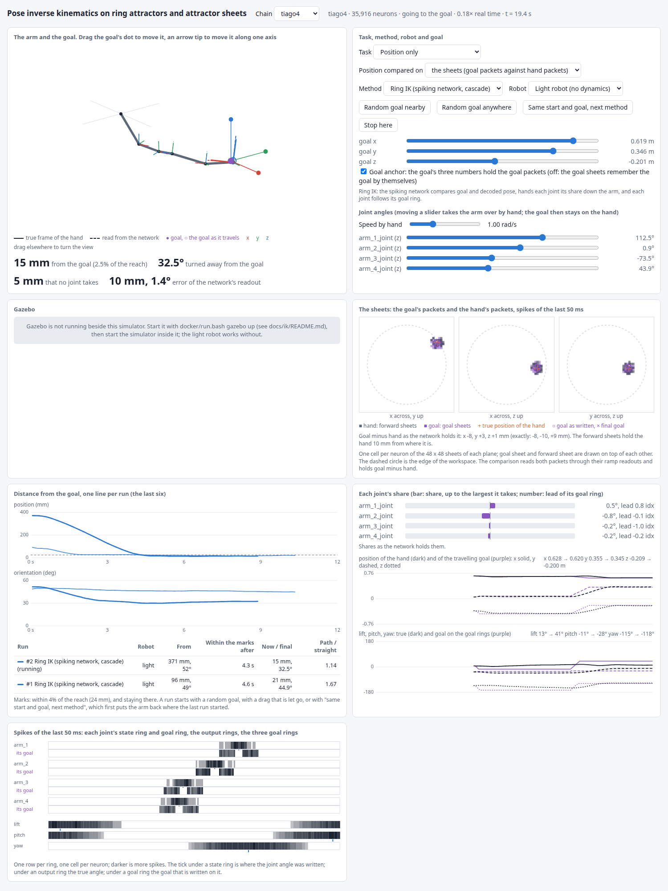

# The IK demonstration: give the hand a goal and watch the arm go there

One page in a browser. You set a goal for the hand, a position or a whole pose, and the
spiking network takes the arm there: it compares the goal with the pose it decodes, hands
every joint a share, and each joint follows its own goal ring. The page shows the arm, the
goal's and the hand's packets on the three sheets, every joint's share, the distance from the
goal over time, and the spikes of every ring.

What is built: [`architecture.md`](architecture.md). What was measured:
[`results.md`](results.md). The mathematics and the spikes:
[`TECHNICAL.md`](../../TECHNICAL.md), parts II and III. The forward simulator (move the arm,
watch the decoded pose) is section 4 of the top-level [`README.md`](../../README.md).

## 1. Start it

At the root of this repo:

```bash
docker/run.bash sim -- 'python3 -B scripts/ik_simulator.py --chain tiago4'
```

1. Wait for the line `IK simulator ready: http://localhost:8765/  (chain tiago4, task position, robot light, Ctrl-C to stop)`.
   Building the network takes a few seconds.
2. Open <http://localhost:8765/>.
3. Press **Random goal nearby**.
4. Ctrl-C in the terminal ends it and removes the container.

Nothing has to be prepared: Docker and the image of section 2 of the top-level README are
all it needs, and the four calibration files are checked in (`artifacts/`).

## 2. Which arm

| Command ends with | The hand is asked for | Neurons | Runs at |
| --- | --- | ---: | --- |
| `--chain tiago4` | a position (x, y, z); 4 joints | 35,916 | 0.66 of real time |
| `--chain tiago7` | a pose (position and lift, pitch, yaw); 7 joints | 69,036 | 0.22 of real time |
| `--chain generic7` | a pose; 7 joints without limits | 71,976 | 0.21 of real time |
| `--chain tiago4 --stub` | either | none | real time |

Speeds: 12 threads on a Ryzen 9 7900X with nothing else running
([`results/tables.md`](results/tables.md), section 4).

- Start with `tiago4`: it is the fast one, and everything that is new against the SO-3
  simulator is in it (goal sheets, level cells, ramp readouts, the offset, shares that take
  the lever into account).
- The 7-joint arms show the whole thing, turn and offset together. The page then shows the
  arm in slow motion; the status line at the top says how slow.
- The TIAGo chains can also move the TIAGo arm in Gazebo instead of the light robot
  (section 6).
- `--stub` replaces the spiking network by the exact rule with a little noise: the page
  works the same, without spikes that mean anything. `python3 scripts/ik_simulator.py --stub`
  runs on the host with nothing but NumPy.
- The chain can also be changed on the page (the selector at the top); the network is then
  built again.

## 3. What the page shows



| Panel | What is in it |
| --- | --- |
| **The arm and the goal** | the arm in 3D with the true frame of the hand (solid) and the decoded one (dashed); the goal in purple: a dot with three arrows and, when an orientation is asked for, a ring around each axis; a small circle for the goal as it travels. Below: how far the hand is from the goal, how much of the error no joint takes, and how far the network's own readout is off |
| **Task, method, robot and goal** | the selectors, the buttons, six goal sliders (x, y, z; lift, pitch, yaw), the goal-anchor switch, and one slider per joint to take the arm over by hand |
| **Gazebo** | with Gazebo as the robot: the picture of its camera, its time, and how far a joint is behind its target. Otherwise one line that says how to start it |
| **The sheets** | the three planes (xy, xz, yz), one cell per neuron: the hand's packet on the forward sheet (dark) and the goal's packet on the goal sheet (purple) on top of each other, with the true position of the hand (+), the goal as written (○) and the final goal (×). Below: goal minus hand as the network holds it, next to the exact one |
| **Distance from the goal** | one line per run for the last six runs (dashed: a run in Gazebo), position in mm and orientation in degrees, and a table: the robot, where the run started, after how long it was within the marks, where it is now, and the length of the end point's path against the straight line |
| **Each joint's share** | a bar per joint (its share, up to the largest it takes) and the lead of its goal ring in ring indices; the hand's and the travelling goal's x, y, z over time; lift, pitch and yaw over time |
| **Spikes** | every joint's state ring and goal ring, the output rings and the three goal rings: one row per ring, one cell per neuron |

The status line at the top: the chain, the number of neurons, what the arm is doing (at rest,
going to the goal, moved by hand, going back to the start pose), how fast the network runs
against real time, and the network's time.

## 4. A demonstration, step by step

With `--chain tiago4`. Each step says what to do and what to look at.

**1. At rest.** After the start nothing is asked: the goal sits on the hand.

- In each of the three planes there are two packets on top of each other, a dark one (the
  hand, on the forward sheet) and a purple one (the goal, on the goal sheet).
- The line under the planes reads a goal-minus-hand of a few millimetres: the two packets
  are compared all the time, and what is left is the error of the comparison itself.
- The share bars are near zero and flicker: a share of zero is a firing pattern, not silence.

**2. One goal.** Press **Random goal nearby**.

- The purple dot jumps to the goal. The small circle, the goal *as it is written*, leaves
  the hand and travels to it on a straight line, at 0.3 reaches per second.
- On the sheets the purple packets move ahead and the dark packets follow them. The
  comparison never sees the whole distance, only the goal a little ahead of the hand.
- The share bars fill: each joint takes the part of the offset that it can remove, the base
  joint first, and hands the rest on. The number beside a bar is the lead of that joint's
  goal ring over its state ring; in the spikes panel the goal ring's activity sits beside the
  state ring's bump on that side.
- The line of the run falls in the chart. When the hand is within the mark and stays there,
  the table says after how many seconds, and the last column says how much longer the end
  point's path was than the straight line.

**3. Move the goal yourself.** Drag the purple dot (it moves in the plane of the screen), or
the tip of one of its arrows (it moves along that axis), or use the sliders goal x, y, z.
While you drag, the arm follows; letting go starts a new run. Drag anywhere else to turn the
view.

**4. The same goal with another method.** Press **Same start and goal, next method**.

- The arm is put back where the last run started, and the same goal is given again, now to
  the exact cascade (the same rule computed from the true joint angles, no neurons). Press
  again for damped least squares, again for the Jacobian transpose, again for the ring IK.
- The chart overlays the runs. This is the comparison that the results make on 30 to 40
  pairs per arm ([`results.md`](results.md)).
- With any method but the ring IK the spiking network still runs and shows its sheets and
  rings; only the joints are moved by the other method.

**5. The goal sheets remember.** Untick **Goal anchor**, then move a goal slider.

- The three numbers of the goal no longer reach the goal sheets. The purple packets stay
  where they were, held by the sheets' own activity, and the arm stays with them: the goal
  that counts is the one on the sheets.
- Tick the box again: the packets go to the goal that the sliders say, and the arm follows.
- A packet without its anchor drifts slowly and can go out
  ([`../results.md`](../results.md), section 7); this switch is there to show that the goal
  is a packet, not to run long trials without the anchor.

**6. Take the arm over by hand.** Move a joint slider. The arm goes where the sliders say and
the goal stays on the hand, so nothing is asked of the arm. **Stop here** does the same in
the middle of a run: the goal comes to the hand.

**7. Another task.** The **Task** selector switches between position, orientation and pose;
**Position compared on** between the sheets (as built) and the goal's three numbers against
the position cells (the version without goal sheets, built for comparison). Both rebuild the
network, since the cascade is wired in; the arm keeps its pose. A pose asks six things of
the hand and `tiago4` has four joints: with the task `pose` on this arm the hand ends
between the position and the orientation that were asked for. For pose goals take a 7-joint
arm.

**8. A goal that is not reached.** Press **Random goal anywhere** a few times. These goals
are taken from the whole joint range, far from the hand.

- When a goal is missed, **that no joint takes** (under the arm) stays above zero, a share
  bar stays filled against a joint limit, or all shares are small although the hand is not
  there: the arm is in a pose from which no joint moves the hand toward the goal.
- This is the limit of the rule, not of the spikes: the exact cascade misses most of the
  same goals (press **Same start and goal, next method**). The measured share is in
  [`results.md`](results.md).

## 5. The same with a pose goal

```bash
docker/run.bash sim -- 'python3 -B scripts/ik_simulator.py --chain tiago7'
```

- The goal has a ring around each of its axes. Drag a ring to turn the goal about that
  axis; the sliders goal lift, pitch, yaw do the same.
- The chart of the orientation is in use now, and a run counts as within the marks when the
  hand is within 5° **and** 4% of the reach.
- Seven share bars. A joint's share is one number that serves the turn and the offset at
  once; the balance between the two is fixed (a reach of offset counts as 3 rad of turn).
- The network runs well below real time; the status line says how fast.

## 6. With the TIAGo in Gazebo as the robot

The same loop, with the simulated TIAGo arm in place of the light robot: its own trajectory
controller, gravity, and joints that are a little behind what they are told. Paste the three
steps one at a time, each in a terminal at the root of this repo.

**1. Start Gazebo** (the TIAGo in a world with nothing but the ground, a light and a
camera). It runs in the background, and the command returns after about a minute with
"Gazebo ready".

```bash
docker/run.bash gazebo up ik-gazebo --gpu
```

**2. Start the simulator beside it.** This one stays in the foreground. When it prints
"IK simulator ready", open <http://localhost:8765/> and press **Random goal nearby**; the
robot selector already says "TIAGo in Gazebo".

```bash
docker/run.bash gazebo exec ik-gazebo -- 'python3 -B scripts/ik_simulator.py --chain tiago7 --gazebo'
```

**3. Stop.** Ctrl-C in the terminal of step 2 ends the simulator; this ends Gazebo:

```bash
docker/run.bash gazebo down ik-gazebo
```

What to expect:

- Every joint of the Gazebo arm is sent the angle its goal ring holds. Gazebo's physics
  advances 50 ms for every tick of the network, so nothing runs away while the network is
  slower than real time.
- The **Gazebo** panel shows the camera picture, and under it Gazebo's time and the largest
  distance of a joint from its target.
- `--chain tiago4 --gazebo` asks for the position alone and moves the first four joints; the
  wrist joints are held where they are.
- **Robot** switches between the Gazebo arm and the light robot while the network keeps
  running. The light robot takes over at the pose the Gazebo arm is in. Runs in Gazebo are
  drawn dashed, so the same goal can be compared on both (**Same start and goal, next
  method** puts the Gazebo arm back through its controller).
- The generic chains have no arm in Gazebo: with one of them the selector offers the light
  robot only.

If something is in the way:

- **Port 8765 is taken**: step 1 says so. Use another port in step 1 only, and open that
  port in the browser; the simulator of step 2 picks it up by itself.

  ```bash
  docker/run.bash gazebo up ik-gazebo --gpu --port 8766
  ```

- **No NVIDIA GPU, or no desktop session**: leave `--gpu` out in step 1. Everything works
  except the camera picture; the panel says so, and the arm on the page is drawn from
  Gazebo's joint angles as before.

  ```bash
  docker/run.bash gazebo up ik-gazebo
  ```

- **"a container named ik-gazebo exists already"**: an earlier Gazebo is still running; run
  step 3 first.
- **The simulator was closed without Ctrl-C** (the terminal was shut): step 3 stops it
  together with Gazebo.

Closed-loop trials in Gazebo without a browser, as test 10 runs them
([`tests.md`](tests.md)), between steps 1 and 3 (start Gazebo with
`--out /tmp/ring-se3` in step 1 so that the result lands there; no `--gpu` needed):

```bash
docker/run.bash gazebo exec ik-gazebo -- 'python3 -B scripts/run_ik_gazebo.py --chain tiago4 --pairs 3 --out /out/gazebo_try.json'
```

## 7. Options

| Option | Effect |
| --- | --- |
| `--chain NAME` | `generic2` .. `generic7`, `tiago2` .. `tiago7` (default `tiago4`) |
| `--task pose`, `position`, `orientation` | what the hand is asked for (default: pose from six joints on, else position) |
| `--position-goal sheets`, `cells` | compare positions on the sheets (default), or the goal's numbers with the position cells |
| `--method ring`, `cascade`, `dls`, `transpose` | the method the page starts with |
| `--gazebo` | a Gazebo with the TIAGo runs beside the simulator (section 6): offer it as the robot |
| `--robot light`, `gazebo` | the robot the page starts with (default: Gazebo with `--gazebo` and a TIAGo chain) |
| `--stub` | the exact rule instead of the spiking network; needs no NEST |
| `--threads N` | threads NEST uses (default 12) |
| `--port N` | the port inside the container (default: the one `docker/run.bash sim --port N` publishes, 8765) |
| `--ticks N` | stop by itself after N ticks of 50 ms |

## 8. If something is in the way

- **The page says "connecting…" and nothing moves.** The network is still being built; wait
  for the "ready" line in the terminal. If your browser or a proxy does not pass event
  streams, open <http://localhost:8765/?poll>.
- **Port 8765 is taken** (the forward simulator of this repo, or a simulator of the other
  repos): publish another one, and open that one.

  ```bash
  docker/run.bash sim --port 8766 -- 'python3 -B scripts/ik_simulator.py --chain tiago4'
  ```

- **It is slow.** Give NEST more threads (`--threads`), close other simulations, or take a
  shorter arm; `--chain tiago3` and `--chain generic4` are also position tasks.
- **The arm does not move after a new goal with the goal anchor off.** That is the switch
  doing its work (step 5): tick it again.
- **No NEST, no Docker.** `python3 scripts/ik_simulator.py --stub` and open the same address.

## 9. Without a browser

```bash
docker/run.bash nest -- 'python3 -B scripts/ik_example.py'
docker/run.bash nest --out /tmp/ring-se3 -- 'python3 -B scripts/run_ik_reach.py --chain tiago4 --pairs 3 --out /out/reach_try.json'
```

- `scripts/ik_example.py` builds the network for `tiago4`, gives the hand one goal and
  prints the distance from it every half second. It is the shortest way into the code.
- `scripts/run_ik_reach.py` runs closed-loop trials as the tests do and prints one line per
  trial, with the exact rule on the same pair beside it. Every tick of every trial is in the
  JSON file.
- All measurements, and the report that turns them into tables and figures: the top-level
  [`README.md`](../../README.md), section 11.
