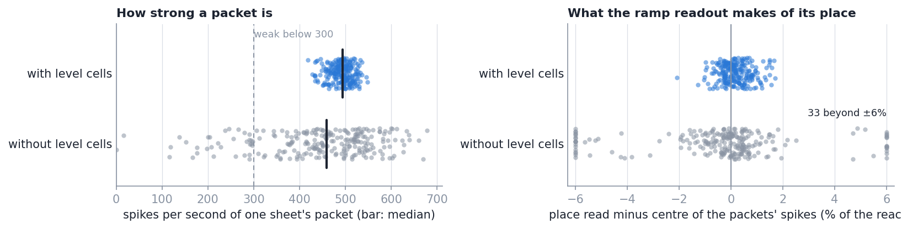
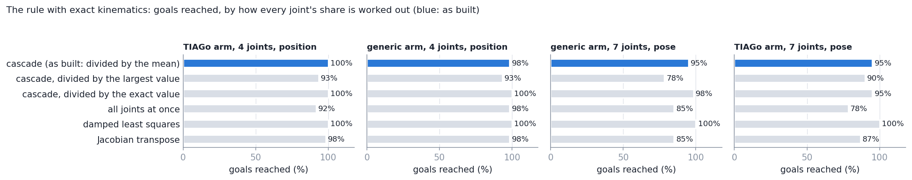
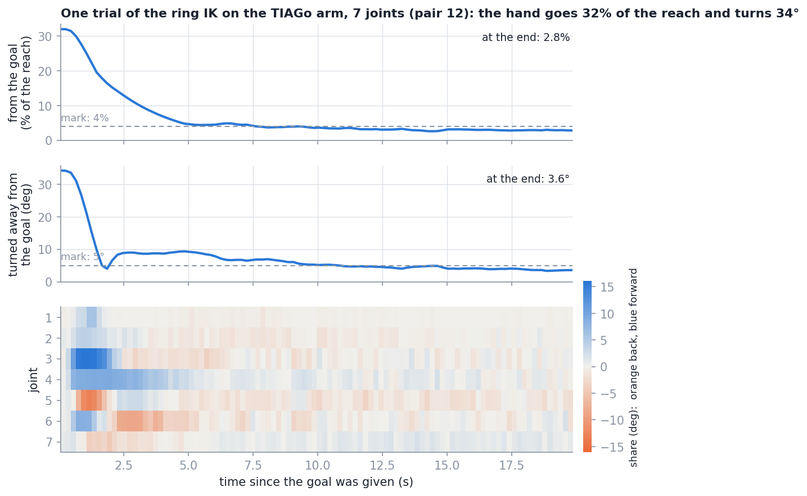
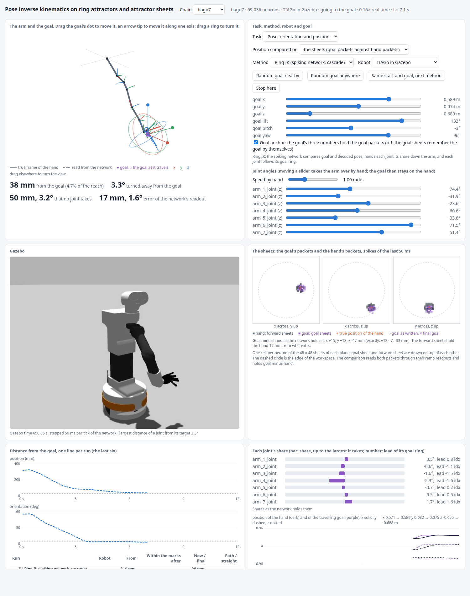

# Results: taking the hand to a pose with rings and sheets

Date: 2026-10-10, branch `ik-pose`. NEST `HEAD@41892a5`, the pinned image, one machine (AMD
Ryzen 9 7900X). What is built: [`architecture.md`](architecture.md). What each test asks and
its mark: [`tests.md`](tests.md). Every table in full:
[`results/tables.md`](results/tables.md); the data: [`results/data/`](results/data/README.md).
How to rerun any of it: the top-level [`README.md`](../../README.md), section 11.3.

Everything here is the **ring IK**: the spiking network of this repo that takes the hand to
a pose goal. `tiago4`, `tiago7`, `generic4` and `generic7` are the arms it was built for (the
first 4 or all 7 joints of the TIAGo arm; chains of 4 and 7 joints without limits). They are
not names of the method. The 4-joint arms are asked for a position, the 7-joint arms for a
pose. A goal counts as reached when the hand ends within 4% of the reach and, for a pose,
within 5° of it. Position errors are given as a share of the arm's reach.

## Summary

- **The loop closes on a full pose.** On the test pairs the spiking network reaches 97% of
  the pose goals with the 7-joint generic arm and 93% with the 7-joint TIAGo arm (30 pairs
  each), and 98% and 100% of the position goals with the two 4-joint arms (40 pairs each).
  The same rule in exact arithmetic reaches 95% to 100% of these pairs.
- **At the end the hand is about 2% of the reach and 2° from the goal.** Median over the
  goals reached: 1.24% to 2.02% of the reach, and 2.27° and 1.95° for the two 7-joint arms.
  For the TIAGo arm 2.09% is 16.8 mm.
- **It gets there in about five seconds**: within the marks after 4.0 to 5.7 s in the median.
- **One mark is missed.** The end point's path is 1.54 times the straight line for the
  7-joint generic arm, where at most 1.5 was asked. The other marks are met.
- **It works with the TIAGo in Gazebo as the robot.** With the arm's own controller and
  gravity, the ring IK reaches 93% of 30 pose goals, all 28 of the goals it reaches on the
  light robot, and 100% of 20 position goals with four joints. The loop gain was not changed.
- **The sheets can be compared because of two additions.** Level cells hold a packet's
  strength: without them 33 of 240 packets are weak, with them none. With them the ramp
  readout gives a packet's place to 0.59% of the reach, without to 6.26%.
- **Comparing positions on the sheets costs a little against comparing numbers**: 1.96%
  against 1.62% at the end with four joints, 2.09% against 1.70% with seven, and as many
  goals reached within one.
- **Handing the error down the arm matters.** With every joint getting the whole error the
  4-joint arm reaches 88% of its goals instead of 98% and needs 8.1 s instead of 4.5 s.
- **A standard method with exact joint angles is better.** Damped least squares in Gazebo
  reaches 100% of the same 30 goals and ends 0.29% and 0.35° from them. The ring IK is not
  more exact; it is made of the same neural parts as the forward network and needs no solver.
- **Goals far from the hand are often missed, by the rule itself.** With goals anywhere in
  the joint ranges the spiking network reaches 70% (4 joints); the exact cascade reaches 37%
  to 77% across the four arms.

## 1. What was measured and how

| | |
| --- | --- |
| Arms | `tiago4`, `generic4` (position goals); `generic7`, `tiago7` (pose goals) |
| Network | the pose network with level cells on its sheets, and the IK layer: 35,916 neurons for four joints, 69,036 and 71,976 for seven |
| A goal | the pose of a joint pose within 0.8 rad of the start pose, joint by joint: it can be reached |
| A trial | the arm is put at the start pose; the goal is given and travels to its place; the trial ends when the hand rests, or after 25 s |
| True pose | the exact kinematics at the robot's joint angles; in Gazebo these agree with Gazebo's own link states to 0.22 mm |
| Robots | the light robot (joint angles that move as told), and the TIAGo arm in Gazebo |
| Beside every trial | the same rule in exact arithmetic on the same pair |
| Marks | fixed before the test pairs ran ([`tests.md`](tests.md)); every one met or missed is in section 0 of the tables |

Speed with 12 threads and nothing else on the machine: 0.66 and 0.63 of real time for the
4-joint networks, 0.21 and 0.22 for the 7-joint ones.

## 2. The sheets as the comparison needs them (test 3c)

Three sheets on their own, anchored through gate populations at 80 places the readout was
not fitted on.

| Sheets | A packet's spikes per second, median | sd | Weak or out | Ramp readout off by, rms | largest |
| --- | ---: | ---: | --- | ---: | ---: |
| without level cells (as in the forward network) | 459 | 120 | 33 of 240 weak, 2 of them out | 6.26% | 46.53% |
| with level cells (as in the IK network) | 494 | 24 | none | 0.59% | 2.09% |

- **Without level cells a sheet cannot be read as a number.** The anchor's height is off by
  some tens of pA from place to place, and a ramp grows with the packet's strength as well
  as with its place.
- **The level loop behaves as a proportional loop should.** Other gains and synapses were
  tried afterwards: a gain of 300 pA with a 30 ms synapse makes the strength swing (632
  spikes per second from tick to tick against 69 as built), as the model of
  [`TECHNICAL.md`](../../TECHNICAL.md), section 21, says it must.
- **In a whole network** the ramp readouts are off by 1.16% to 1.39% of the reach for the
  hand and 1.00% to 1.21% for the goal (section 3 of the tables): the hand's side carries
  the error of the forward network as well.

## 3. The rule itself, with exact kinematics (test 2)

60 pairs per arm that are not the test pairs, with a delay, share noise and a readout error
like the network's.

| What was varied | Outcome |
| --- | --- |
| What a share is divided by | the mean over the joint range (built): 95% to 100% reached. The exact value, which needs a division: 95% to 100%. The largest value: 78% to 93% |
| Cascade or all joints at once | all at once: 78% to 98% reached, within the marks after 7.8 to 11.7 s against 4.1 to 5.5 s |
| Order, and a second sweep | from the hand to the base: 97% to 100%. Twice per tick: within the marks after 3.0 to 4.3 s |
| Balance | 2 is slower on every arm (5.7 to 7.6 s); 4 and 5 reach fewer goals on the 7-joint TIAGo arm (93% and 90% against 95%) |
| Loop gain | 0.75: 6.3 to 6.8 s. 1.5: 3.5 to 4.0 s, with a path of 1.80 to 1.95 times the straight line |
| How far the goal is | within 0.4 rad per joint: 100%. Within 1.2 rad: 88% to 97%. Anywhere: 37% to 77% |
| Standard methods | damped least squares: 100% near, 53% to 80% anywhere. Jacobian transpose: 85% to 98% near |

These runs set the design. No spiking run entered.

## 4. Comparisons and shares in spikes (tests 3a, 3b)

The arm held at a pose, with a goal part of the way to another pose.

| Arm | Turn: direction off by, median | Offset off by, median | Shares above 0.05 rad with the right sign | Share error, rms |
| --- | ---: | ---: | ---: | ---: |
| `tiago4`, position | – | 1.36% | 100% of 80 | 0.0121 rad |
| `generic7`, pose | 2.9° | 1.37% | 100% of 148 | 0.0162 rad |
| `tiago7`, pose | 4.6° | 1.74% | 100% of 131 | 0.0169 rad |

All three marks are met (10°, 2% of the reach, 95%). The share error does not grow along the
arm: 0.011 rad at the first joint of `tiago7` and 0.018 rad at the seventh.

## 5. Reaching and trajectory (tests 4, 5)

| Arm, task | Trials | Reached | Exact rule reaches | Final position error, median / p90 | Final orientation error, median / p90 | Within the marks after | Path / straight |
| --- | ---: | ---: | ---: | ---: | ---: | ---: | ---: |
| `tiago4`, position | 40 | 98% | 95% | 1.96% / 3.16% | – | 4.5 s | 1.36 |
| `generic4`, position | 40 | 100% | 100% | 1.24% / 2.03% | – | 4.0 s | 1.32 |
| `generic7`, pose | 30 | 97% | 100% | 2.02% / 3.30% | 2.27° / 3.54° | 5.0 s | 1.54 |
| `tiago7`, pose | 30 | 93% | 97% | 2.09% / 3.48% | 1.89° / 3.00° | 5.7 s | 1.43 |

- **The four goals that were missed** are listed in section 7 of the tables. None ended with
  a joint at a limit. Two of them the exact rule misses as well.
- **The hand does not always come to rest.** With the 4-joint TIAGo arm the median trial
  runs the whole 25 s: the hand is within the mark after 4.5 s and then keeps moving by more
  than the 0.4% of the reach that counts as rest. A sheet read from one tick of its spikes
  scatters by 2.7% of the reach ([`TECHNICAL.md`](../../TECHNICAL.md), section 34).
- **The network's own readout sets the floor.** During these trials the position read from
  the forward sheets is off by 1.26% to 1.68% of the reach and the decoded orientation by
  0.99° to 1.61°, in the median. The hand goes where the network believes the goal is.

## 6. Sheets or numbers; with and without the cascade (tests 6, 7)

| Arm, task | Variant | Trials | Reached | Final position error, median | Final orientation error, median | Within the marks after |
| --- | --- | ---: | ---: | ---: | ---: | ---: |
| `tiago4`, position | as built: positions compared on the sheets | 40 | 98% | 1.96% | – | 4.5 s |
| `tiago4`, position | positions compared as numbers | 40 | 98% | 1.62% | – | 4.8 s |
| `tiago4`, position | every joint gets the whole error, gain 0.5 | 40 | 88% | 2.33% | – | 8.1 s |
| `tiago7`, pose | as built | 30 | 93% | 2.09% | 1.89° | 5.7 s |
| `tiago7`, pose | positions compared as numbers | 20 | 95% | 1.70% | 1.63° | 5.8 s |
| `tiago7`, orientation alone | the cascade of the SO-3 repo in this network | 20 | 100% | – | 1.54° | 3.1 s |

- **The sheets in the loop cost about a third of a percent of the reach.** On the same pairs
  the version with sheets is the closer one in 40% of the trials (4 joints) and 30% (7
  joints). What the sheets add is a goal that is held as a packet, not accuracy.
- **Orientation alone is easier**: all 20 goals, in 3.1 s. Adding the position costs time
  and two goals.

## 7. Disturbances (test 8)

`tiago4`, position goals, the first 20 test pairs.

| Condition | Reached | Final position error, median | Within the marks after |
| --- | ---: | ---: | ---: |
| nothing in the way | 100% | 1.62% | 4.7 s |
| the robot moves 30% less than told | 95% | 1.69% | 6.5 s |
| the robot moves 30% more than told | 100% | 1.42% | 4.1 s |
| one joint pushed 0.3 rad after 4 s | 100% | 1.52% | 5.7 s |
| the goal changes after 4 s | 80% | 2.30% | 17.5 s |
| goals anywhere in the joint ranges | 70% | 2.15% | 11.4 s |

- **A wrong motor gain and a push are absorbed**: that is what the closed loop is for.
- **A changed goal is the hard case.** The new goal is that of the next pair, far from where
  the hand is by then. 16 of 20 are reached; three of the four misses end with a joint at a
  limit, and the exact rule reaches 75%.

## 8. How good is it

- **It does what was asked**: a pose goal on rings and sheets, compared in spikes, turned
  into joint motion without a solver, in closed loop, on arms of four and seven joints.
- **It is as good as its rule and its readout allow.** It reaches 97% to 100% of the goals
  the exact rule reaches, and ends about as far from the goal as the forward network is
  from the truth.
- **It is not as good as a standard method that is given the exact joint angles**, by a
  factor of about seven in the final position error in Gazebo (2.22% against 0.29%).
- **It is slow**: a fifth of real time for seven joints.

## 9. Gazebo as the robot (test 10)

The TIAGo arm in Gazebo, physics advanced 50 ms per tick of the network, the same test pairs.

| Arm, task | Robot, method | Trials | Reached | Final position error, median | Final orientation error, median | Within the marks after | Path / straight |
| --- | --- | ---: | ---: | ---: | ---: | ---: | ---: |
| `tiago7`, pose | light robot, ring IK | 30 | 93% | 2.09% | 1.89° | 5.7 s | 1.43 |
| `tiago7`, pose | Gazebo, ring IK | 30 | 93% | 2.22% | 1.50° | 5.8 s | 1.50 |
| `tiago7`, pose | Gazebo, damped least squares | 30 | 100% | 0.29% | 0.35° | 4.7 s | 1.01 |
| `tiago4`, position | light robot, ring IK | 20 | 100% | 1.62% | – | 4.7 s | 1.40 |
| `tiago4`, position | Gazebo, ring IK | 20 | 100% | 1.74% | – | 4.9 s | 1.37 |

- **Test 10a.** At 5 held poses per arm the end point from Gazebo's own link states and the
  chain's kinematics differ by 0.22 mm at most (mark 1 mm).
- **Test 10b.** The ring IK reaches in Gazebo all 28 goals it reaches on the light robot
  (mark 80%). The two goals it misses are missed on the light robot as well.
- **Dynamics change little.** In the median a joint is 2.30° behind the target it was sent
  (7 joints) and 1.10° (4 joints). In no trial did a joint end more than 3° from its target,
  so the arm was not stopped by its own body. The base moved by 12.7 mm at most.

## 10. The claims and what supports them

| Claim | Evidence | Limit |
| --- | --- | --- |
| A spiking network takes the hand to a pose goal in closed loop | section 5: 97% and 93% of 30 pose goals, 98% and 100% of 40 position goals | goals near the start pose; 30 to 40 pairs per arm, one seed |
| No solver is needed: every joint takes a share and hands on the rest | section 3: with a constant divisor 95% to 100% of the goals, as with the exact division | the exact kinematics of the arm are wired in |
| A position on attractor sheets can be compared as a number | section 2: ramp readout off by 0.59% of the reach with level cells | without them 6.26%; one tick of spikes scatters by 2.7% |
| The hand ends about 2% of the reach and 2° from the goal | section 5: 1.24% to 2.09% and 1.89° to 2.27° in the median | no better than the forward network's own readout (1.26% to 1.68%) |
| It works with a simulated robot that has dynamics | section 9: 93% of 30 and 100% of 20 goals in Gazebo, all 28 of those reached on the light robot | one robot, in simulation; no real arm |
| The loop absorbs a wrong motor gain and a push | section 7: 95% to 100% reached | 20 pairs, four joints |

Not claimed, because not supported: that it is more exact or faster than a standard method
(it is neither); that it reaches goals anywhere in the workspace (70%, and the rule itself
37% to 77%); that it tolerates noise or the loss of neurons (not measured for this layer);
that it needs no model of the arm (the arm's geometry is in the wiring).

## 11. What limits it, and what would improve it

| Limit | Measurement | What would help |
| --- | --- | --- |
| The hand ends where the network believes the goal is | final error about that of the forward readout (section 5) | a more exact forward network; or the hand's pose sensed from outside |
| A sheet says little per tick | one tick scatters by 2.7% of the reach; half of the `tiago4` trials never come to rest | a packet with more spikes; a slower synapse on the offset; a small dead zone on the shares |
| Far goals are missed | 70% with goals anywhere; exact cascade 37% to 77% | goals in between (a planner); a pull of the joints toward the middle of their ranges |
| One sweep of the cascade per tick | exact rule: 3.0 to 4.3 s with two sweeps against 4.1 to 5.5 s | a second sweep, at twice the products |
| The path is not straight enough on one arm | 1.54 against a mark of 1.5 (`generic7`) | the same as the two rows above |
| Speed | 0.21 of real time for seven joints | fewer neurons per product; neuromorphic hardware |
| The arm's geometry is wired in | link offsets and joint axes are weights | the next step, below |

**The next step: the same loop with learned kinematics.** The loop needs two things as
activity of populations: where the hand is, and how each joint turns and moves it. Here both
are computed from the arm's geometry. Nothing in the comparison, the cascade or the goal
rings depends on where they come from, so both could be learned from the arm's own motion
(motor babbling) and supplied in their place. What these results say about that: the loop
forgives a rough estimate of what a joint does (it costs time, not the goal), and it does
not forgive a wrong estimate of where the hand is (section 5, and the exact rule with a
readout that is off by 2.6% ends 2.6% away). Not built.

## 12. The simulator

`scripts/ik_simulator.py`; [`README.md`](README.md) walks through a demonstration. With the
goal anchor switched off on the page, the goal sheets kept a goal for the 6 s tried while
the goal's numbers were changed, drifting by about 36 mm, and the hand stayed with them;
with the anchor on again packets and hand went to the new goal.
