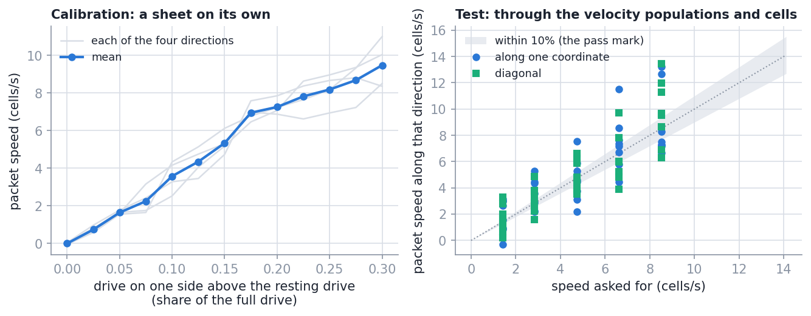
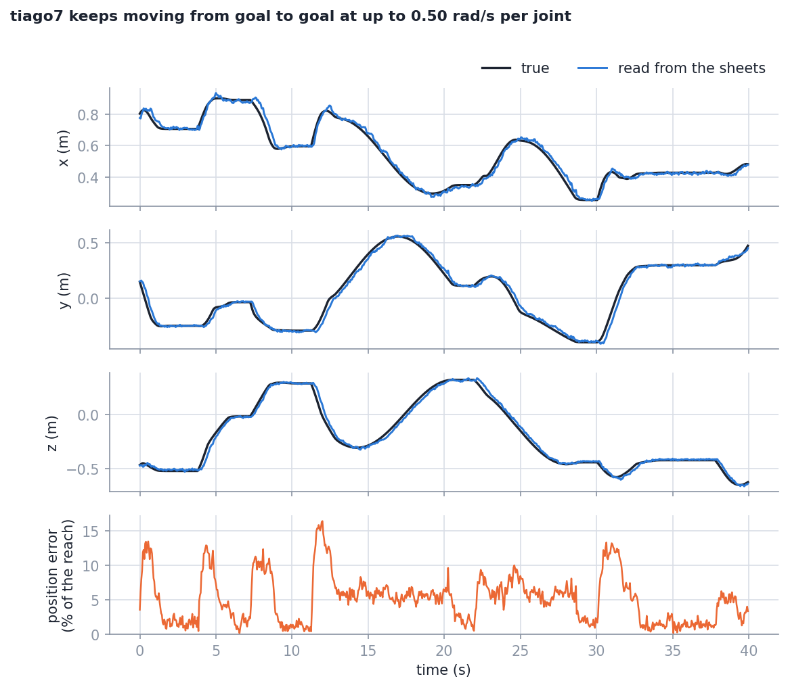
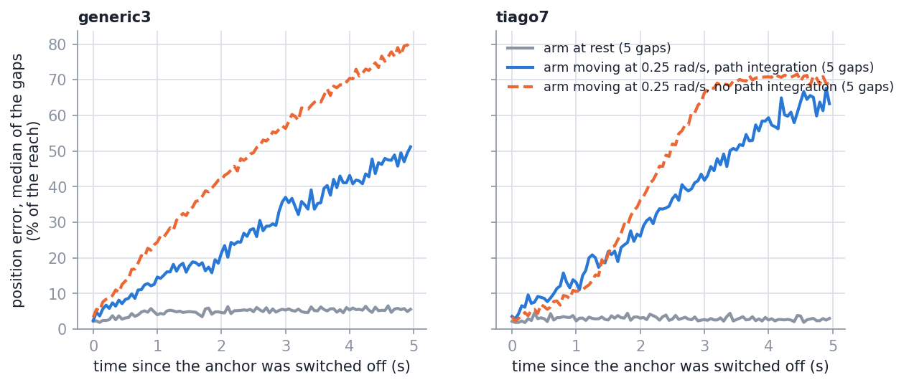
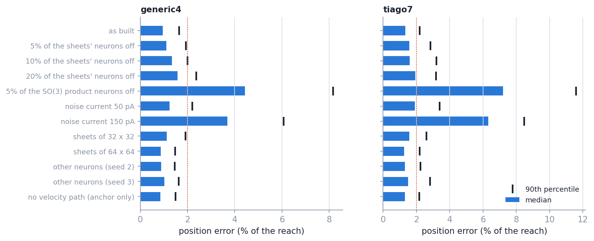
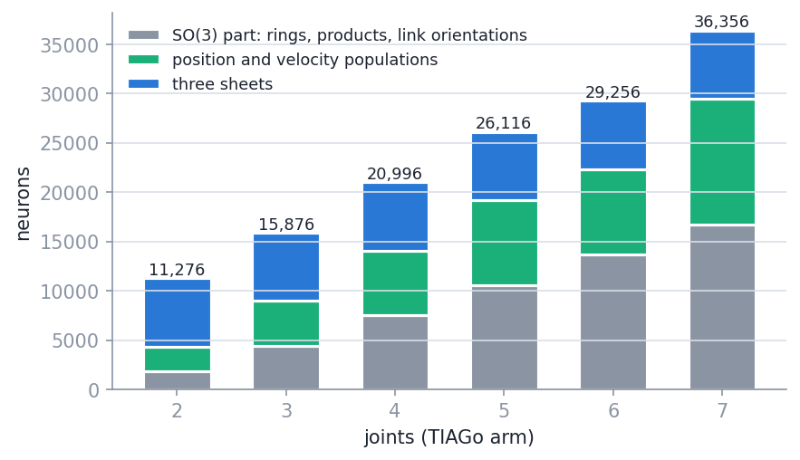
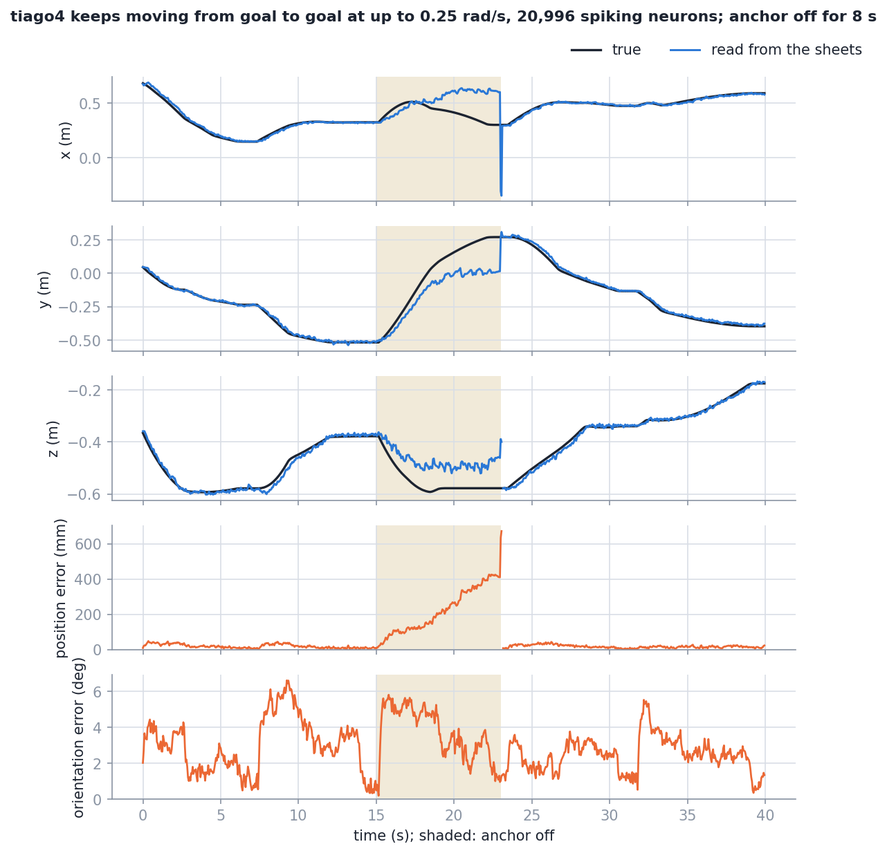
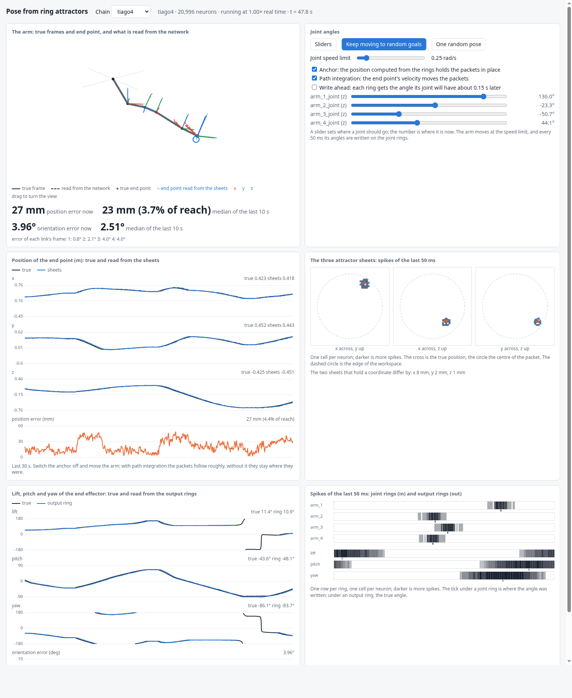
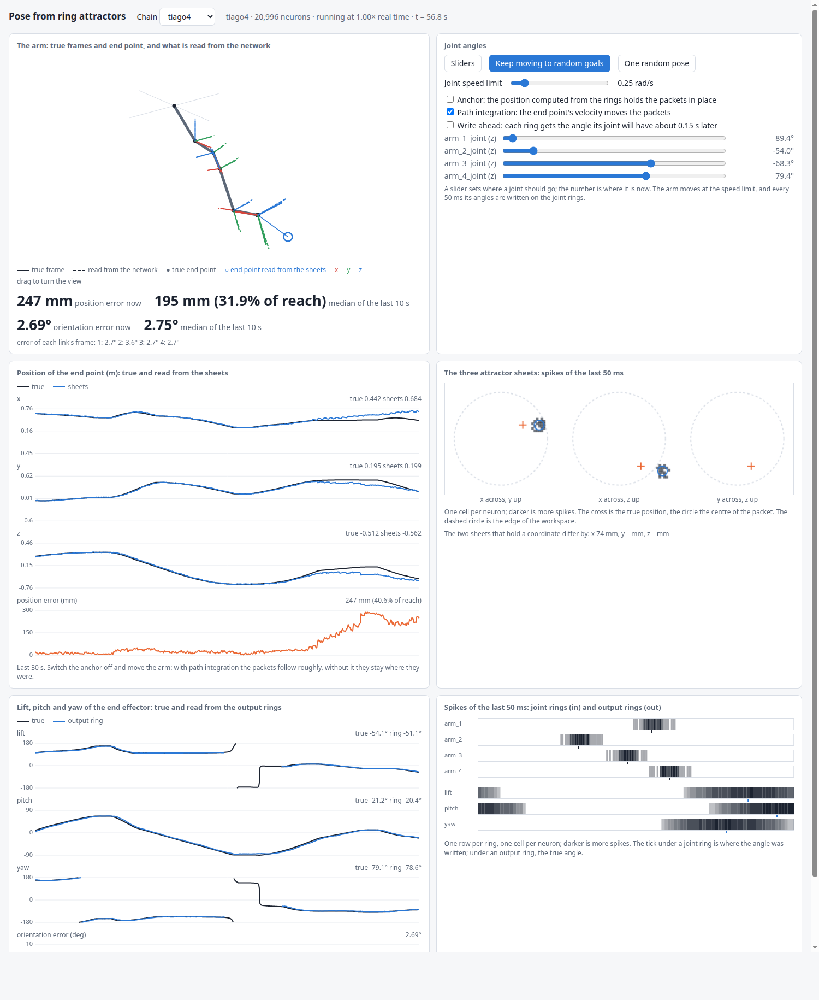

# Results: the pose of the arm, read out from the joint rings

Date: 2026-10-05, branch `fk-pose`. NEST `HEAD@41892a5`, the pinned image, one machine
(AMD Ryzen 9 7900X). What the network is: [`architecture.md`](architecture.md). What each
test asks and its pass mark: [`tests.md`](tests.md). Every table in full:
[`results/tables.md`](results/tables.md); the data: [`results/data/`](results/data/README.md).
How to rerun any of it: the top-level [`README.md`](../README.md), section 3.

Position error is the distance between the decoded and the true end point, as a share of
the arm's reach (0.806 m for the 7-joint TIAGo arm). Numbers are given as median / 90th
percentile / largest.

## Summary

- **The position of the end point is read from the rings, for 2 to 7 joints.** Over 300
  random held poses per model the position read from the three sheets is off by 0.97% to
  1.37% of the reach in the median; the largest 90th percentile of any model is 2.34%. For
  the 7-joint TIAGo arm that is 11.1 mm / 18.6 mm / 32.8 mm. All 12 models meet the mark
  set beforehand (median at most 2%, 90th percentile at most 4%).
- **With the orientation of the SO(3) network this is the full pose.** The orientation is
  unchanged in the larger network: largest median 1.12°.
- **The sheets do not make the position more exact; they hold it.** The three position
  cells that feed the sheets are a little closer on their own (7 joints: 1.28% against
  1.37%). What the sheets add is a place code and a state that persists.
- **The packets persist, but they drift.** With the anchor switched off and the arm at
  rest, all three packets were still alive after 10 s in every gap (and in 29 of all 30
  gaps of 2 to 10 s); a packet had moved 4.59% of the reach in the
  median, where at most 2% was asked. This mark is missed.
- **Switching the anchor back on brings the readout back in 0.10 s** in the median; 15 of
  190 gaps took longer than the 0.5 s asked. This mark is missed narrowly.
- **A moving arm is followed 0.21 to 0.23 s behind** at 0.5 rad/s per joint (mark: 0.5 s),
  which costs 5.25% to 7.40% of the reach while the arm moves. Anchoring the sheets at the
  position 0.2 s ahead (position plus velocity times 0.2 s) removes the delay: 2.28% while
  moving for the 7-joint arm, against 5.26%.
- **The velocity of the end point is computed well; moving the packets with it is not.**
  The velocity populations are within 4% to 5% of the true speed for a resting arm. But a
  free packet moves at 0.66 to 1.71 times the speed asked for, where "within 10%" was the
  mark, and in whole networks path integration helped clearly in one condition only (3
  joints, 0.25 rad/s, 2 s without anchor: error 0.52 of the distance travelled, against
  1.21 without). At slow motion it does harm. This is the part that does not work well.
- **Losing sheet neurons is tolerated; noise and losing SO(3) neurons are not.** With 20% of
  the sheets' neurons off the 7-joint position error is 1.93% in the median. A noise
  current of 150 pA gives 6.31%, and 5% of the SO(3) product neurons off gives 7.21%.

## 1. What was measured and how

| | |
| --- | --- |
| Models | `generic2` .. `generic7` (links of 0.2 m, reach 0.4 to 1.4 m) and `tiago2` .. `tiago7` (the first joints of the TIAGo arm, reach 0.22 to 0.806 m) |
| Network | the SO(3) network; three position cells; the velocity path; three sheets of 48 x 48. 11,276 neurons for two joints, 36,356 for seven. One calibration for all 12 models |
| A held pose | the arm moves to the pose at up to 1 rad/s per joint and rests 1 s; the position is the centre of the sheets' spikes of the last 0.5 s |
| True position | the exact kinematics at the robot's joint angles |
| Test poses | the 300 poses per model of the SO-3 repo; first run after the design was frozen (one exception is said in [`tests.md`](tests.md)) |
| "Similar" | median at most 2% of the reach and 90th percentile at most 4%, set before the runs |

The robot is the light one of the simulator: joint angles that move toward a target at a
speed limit. No dynamics, no Gazebo.

## 2. The parts on their own (test 3)

| Part | Result | Pass mark | Met |
| --- | --- | --- | --- |
| A packet left alone, 8 places, 10 s | alive in 8 of 8; moved 0.33 / 0.93 / 1.07 cells, that is 1.65% / 4.67% / 5.33% of the reach | at most 2% in 10 s | **no** |
| A sheet anchored through gate populations, 51 places | off by 0.14 / 0.28 / 0.56 cells, that is 0.71% / 1.40% / 2.82% of the reach | within 1 cell | yes |
| A free packet moved by a known velocity, 79 runs | speed over the speed asked for: median 1.02, 10th to 90th percentile 0.66 to 1.71 | within 10% | **no** |
| Velocity populations, 30 poses each | off by 4% of the true speed in the median (3 joints), 5% (7 joints) | none set | |

- **The anchor works as designed.** Three numbers go in, and the packet sits within a
  seventh of a cell of them in the median.
- **A free packet does not keep its place exactly.** It settles on the lattice of cells and
  wanders by up to a cell in 10 s. The direction labels with their shifted weights, which
  path integration needs, are what unsettle it: a sheet without them (32 x 32, during
  development) held its packet to a few hundredths of a cell over 6 s.
- **The packet's speed is right on average and wrong run by run.** The same drive gives
  speeds that differ by tens of percent between two starts and between directions. The
  packet is about six cells across and its neurons fire some 15 times a second: a push is
  a matter of a few spikes.

## 3. Held poses (test 4)

| Model | Position error (% of reach) | In mm | 95% interval of the median (%) |
| --- | --- | --- | --- |
| generic2 | 0.98 / 1.62 / 2.58 | 3.9 / 6.5 / 10.3 | 0.91 - 1.05 |
| generic3 | 1.03 / 1.70 / 2.61 | 6.2 / 10.2 / 15.6 | 0.94 - 1.08 |
| generic4 | 0.97 / 1.65 / 2.99 | 7.8 / 13.2 / 24.0 | 0.89 - 1.04 |
| generic5 | 0.99 / 1.79 / 3.26 | 9.9 / 17.9 / 32.6 | 0.93 - 1.06 |
| generic6 | 1.00 / 1.83 / 2.95 | 12.0 / 21.9 / 35.4 | 0.94 - 1.09 |
| generic7 | 1.01 / 1.85 / 3.71 | 14.1 / 25.9 / 52.0 | 0.93 - 1.06 |
| tiago2 | 1.05 / 1.84 / 3.16 | 2.3 / 4.0 / 6.9 | 0.98 - 1.12 |
| tiago3 | 1.11 / 1.89 / 2.99 | 4.9 / 8.4 / 13.3 | 1.03 - 1.17 |
| tiago4 | 1.17 / 1.90 / 3.17 | 7.1 / 11.6 / 19.3 | 1.08 - 1.25 |
| tiago5 | 1.35 / 2.23 / 4.48 | 10.3 / 17.0 / 34.0 | 1.30 - 1.42 |
| tiago6 | 1.28 / 2.34 / 3.28 | 9.8 / 17.8 / 24.9 | 1.15 - 1.37 |
| tiago7 | 1.37 / 2.30 / 4.07 | 11.1 / 18.6 / 32.8 | 1.30 - 1.47 |

300 poses per model; no sheet was silent at any pose. All 12 models are "similar". The
error hardly grows with the number of joints for the generic chains and grows slowly for
the TIAGo arm.

The orientation in the same runs (test 10) is what it is in the SO-3 repo: for `tiago7`
1.12° / 1.78° / 2.68° here and 1.14° / 1.69° / 2.62° there
([`results/tables.md`](results/tables.md), section 5).

## 4. Where the position is read (test 5)

Median / 90th percentile, % of reach, the same poses:

| Model | Exact position of the angles the rings hold | Position cells alone | Sheets | Sheets closer than cells |
| --- | --- | --- | --- | ---: |
| generic2 | 0.14 / 0.33 | 0.73 / 1.41 | 0.98 / 1.62 | 31% |
| generic7 | 0.14 / 0.32 | 0.86 / 1.63 | 1.01 / 1.85 | 34% |
| tiago2 | 0.10 / 0.24 | 0.90 / 1.60 | 1.05 / 1.84 | 32% |
| tiago7 | 0.16 / 0.30 | 1.28 / 2.23 | 1.37 / 2.30 | 42% |

- **The joint rings are not the limit**: an exact calculation from the angles they hold is
  off by 0.10% to 0.16%.
- **Most of the error is made before the sheets**, in the SO(3) network and the position
  cells: 0.73% to 1.28%.
- **The sheets add about a tenth to a fifth of a percent.** A cell is 5% of the reach; the
  centre of a packet is found to a fraction of that.

The copy without spikes had predicted 1.03% to 2.81% for the position cells; the spiking
network does better, as it did for the orientation in the SO-3 repo.

## 5. Agreement of the sheets (test 6)

Each coordinate is on two sheets. Their two readings differ by 0.30% to 0.34% of the reach
in the median and by 2.57% at most, in all models. A single sheet is off by 0.71% to 1.22%
in its own plane. So the three sheets see the same position, and what they have in common
(the error of the position cells) is larger than what separates them.

## 6. A moving arm (test 7)

The arm goes from one random goal to the next and rests 1 s at each. The position is read
from the sheets' spikes of the last two ticks.

| Model | Joint speed limit (rad/s) | Delay (s) | Error while moving (% of reach), median / p90 | At rest | 1 s after a stop, median |
| --- | ---: | ---: | --- | --- | ---: |
| generic3 | 0.25 | 0.20 | 3.78 / 5.87 | 1.38 / 2.24 | 1.56 |
| generic3 | 0.50 | 0.21 | 7.40 / 11.57 | 1.41 / 2.41 | 1.22 |
| generic3 | 1.00 | 0.21 | 14.14 / 22.92 | 1.41 / 2.29 | 1.49 |
| generic7 | 0.25 | 0.22 | 2.89 / 5.62 | 1.49 / 2.62 | 1.42 |
| generic7 | 0.50 | 0.23 | 5.25 / 11.72 | 1.38 / 2.40 | 1.42 |
| generic7 | 1.00 | 0.23 | 9.18 / 22.16 | 1.38 / 2.36 | 1.52 |
| tiago3 | 0.25 | 0.21 | 3.66 / 6.66 | 1.42 / 2.38 | 1.26 |
| tiago3 | 0.50 | 0.21 | 6.49 / 13.19 | 1.42 / 2.44 | 1.68 |
| tiago3 | 1.00 | 0.21 | 10.77 / 25.91 | 1.52 / 2.69 | 1.62 |
| tiago7 | 0.25 | 0.21 | 3.02 / 6.00 | 1.54 / 2.51 | 1.44 |
| tiago7 | 0.50 | 0.23 | 5.26 / 11.96 | 1.47 / 2.32 | 1.56 |
| tiago7 | 1.00 | 0.25 | 9.61 / 23.33 | 1.49 / 2.58 | 1.31 |

- **Both pass marks are met**: the delay is under 0.5 s, and 1 s after a stop the readout is
  back at the level of held poses in all 12 sessions.
- **The delay is the SO(3) network's** (0.16 to 0.20 s there) plus a few hundredths of a
  second for the sheets. It does not depend on the speed, so the error while moving is the
  delay times the end point's speed.
- **"At rest" here is one reading of two ticks**; a held pose in section 3 is read over
  ten, which is why it is lower.

Variants at 0.5 rad/s:

| Variant | generic3: delay (s) | error while moving, median (%) | tiago7: delay (s) | error while moving, median (%) |
| --- | ---: | ---: | ---: | ---: |
| as built (anchor and path integration) | 0.21 | 7.40 | 0.23 | 5.26 |
| anchor only (velocity cells silent) | 0.22 | 7.64 | 0.24 | 5.38 |
| anchor given the position 0.2 s ahead | 0.00 | 2.17 | 0.03 | 2.28 |
| joint angles written ahead (the SO(3) option) | 0.06 | 2.62 | 0.05 | 2.31 |

- **With the anchor on, path integration makes no difference.** The anchor holds the packet
  firmly; the velocity cells' pushes are small beside it.
- **The velocity is useful in another way**: added to the position before the gates, as
  "where the end point will be in 0.2 s". That removes the delay for the position. The
  orientation stays late with this option (6.40° while moving for the 7-joint arm); writing
  the joint angles ahead, the option of the SO-3 repo, cures both (1.74°).
- **Limit:** the lead of 0.2 s was set from the delay measured in the SO-3 repo, not tuned
  here; it was tried at one speed.

The velocity populations in these sessions are off by 9% to 18% of the true speed in the
median at 0.25 rad/s and by 28% to 41% at 1 rad/s ([`results/tables.md`](results/tables.md),
section 6c): the link orientations they are computed from are themselves late.

## 7. Without the anchor, arm at rest (test 8a, 8c)

The arm rests at a random pose; the anchor is switched off and on again, five times per
length.

| Model | Anchor off for (s) | Gaps with all three packets alive | Packet moved, median / max (% of reach) | Back after (s), median / max |
| --- | ---: | ---: | --- | --- |
| generic3 | 2 | 4 of 5 | 3.06 / 4.77 | 0.25 / 0.75 |
| generic3 | 5 | 5 of 5 | 4.68 / 7.30 | 0.05 / 0.40 |
| generic3 | 10 | 5 of 5 | 4.54 / 6.88 | 0.05 / 0.30 |
| tiago7 | 2 | 5 of 5 | 5.00 / 10.41 | 0.25 / 0.30 |
| tiago7 | 5 | 5 of 5 | 1.98 / 7.85 | 0.05 / 0.20 |
| tiago7 | 10 | 5 of 5 | 4.71 / 5.67 | 0.05 / 0.70 |

- **The packet is a persistent state**: in 29 of the 30 gaps all three sheets still had
  their packet at the end, in all ten gaps of 10 s among them. In one gap of 2 s one sheet
  lost its packet when the anchor was switched off.
- **It does not keep its place to 2% of the reach.** It moves by about a cell (5% of the
  reach), and no further in 10 s than in 2 s: it settles from where the anchor held it to
  where the lattice lets it rest. The mark is missed.
- **Re-anchoring is fast**: the readout is back at its usual level within one to five ticks
  in most gaps.

## 8. Without the anchor, arm moving (test 8b)

The arm keeps moving from goal to goal while the anchor is off. *Error over distance*: the
position error at the end of the gap divided by how far the end point moved meanwhile. A
packet that stays where it was gives about 1.

| Model | Joint speed limit (rad/s) | Anchor off for (s) | Error over distance with path integration | Without |
| --- | ---: | ---: | ---: | ---: |
| generic3 | 0.1 | 2 | 1.16 | 1.00 |
| generic3 | 0.25 | 2 | 0.52 | 1.21 |
| generic3 | 0.25 | 5 | 0.73 | 1.05 |
| generic3 | 0.5 | 2 | 0.93 | 1.10 |
| tiago7 | 0.1 | 2 | 3.34 | 1.35 |
| tiago7 | 0.25 | 2 | 0.89 | 1.16 |
| tiago7 | 0.25 | 5 | 0.89 | 1.05 |
| tiago7 | 0.5 | 5 | 0.94 | 1.01 |

- **One clear gain**: three joints at 0.25 rad/s, where the error after 2 s is 0.52 of the
  distance travelled against 1.21.
- **At 0.1 rad/s it does harm.** The velocity cells' resting pulses, which are needed for a
  slow motion to move the packet at all, also shake it; the end point moves so little that
  the shaking is the larger effect.
- **At 0.5 rad/s there is little gain**: the end point is then at times faster than the
  packet's top speed (0.47 of the reach per second), and the velocity populations are less
  exact while the arm moves fast (section 6).
- **For the 7-joint arm the gain is small at every speed.**
- **A sheet can lose its packet** while the arm moves without the anchor: in 31 of the 160
  gaps one of the three sheets was silent at the end (column "Packets alive" of the
  table in [`results/tables.md`](results/tables.md), section 8). The position is then read
  from the two that remain.
- **After 10 s nothing is left of it** in any condition ([`results/tables.md`](results/tables.md),
  section 8).

So: path integration, as built, is not a usable dead reckoning. The cause is in section 2:
a packet's speed is right on average but varies by tens of percent from run to run, and
two coordinates on one sheet disturb each other.

## 9. The shift-register experiment

For 2 s the network gets neither the anchor nor the joint velocities, with the arm moving
at up to 0.25 rad/s. A shift register outside the network keeps the last 0.5 s of decoded
positions; the velocity they show is handed to the velocity cells for the gap.

| Handed to the velocity cells | generic3: error at the end, median (% of reach) | tiago7 |
| --- | ---: | ---: |
| nothing | 33.5 | 22.2 |
| the velocity the shift register shows | 36.3 | 24.6 |
| the true joint velocities (path integration) | 14.8 | 21.3 |

No gain from the shift register: the velocity it holds is of the right kind, but the step
from a velocity to a moving packet is the weak one (section 8), and the arm does not keep
its velocity for 2 s anyway.

## 10. Variants and robustness (test 9)

The first 100 random poses, 4 and 7 joints. Position error, median / p90 / max (% of reach):

| Variant | generic4 | tiago7 | Similar |
| --- | --- | --- | --- |
| as built | 0.94 / 1.64 / 2.19 | 1.32 / 2.21 / 4.07 | yes |
| 5% of the sheets' neurons off | 1.10 / 1.93 / 2.55 | 1.58 / 2.84 / 4.17 | yes |
| 10% off | 1.34 / 2.00 / 3.08 | 1.61 / 3.20 / 4.35 | yes |
| 20% off | 1.58 / 2.37 / 3.42 | 1.93 / 3.19 / 5.22 | yes |
| 5% of the SO(3) product neurons off | 4.42 / 8.16 / 14.47 | 7.21 / 11.58 / 15.73 | **no** |
| noise current 50 pA | 1.24 / 2.20 / 2.92 | 1.91 / 3.40 / 4.82 | yes |
| noise current 150 pA | 3.69 / 6.07 / 8.38 | 6.31 / 8.48 / 11.05 | **no** |
| sheets of 32 x 32 | 1.12 / 1.92 / 2.53 | 1.57 / 2.61 / 4.56 | yes |
| sheets of 64 x 64 | 0.86 / 1.48 / 2.43 | 1.27 / 2.18 / 3.87 | one pose of 100 with a silent sheet |
| other neurons (seed 2) | 0.88 / 1.45 / 2.21 | 1.31 / 2.23 / 2.98 | yes |
| other neurons (seed 3) | 1.01 / 1.63 / 2.57 | 1.50 / 2.83 / 3.58 | yes |
| no velocity path (anchor only) | 0.85 / 1.48 / 1.83 | 1.31 / 2.18 / 3.96 | yes |

- **The sheets tolerate losing neurons.** A packet is a group of neurons that keep each
  other going; with a fifth of them gone the centre of the rest is still within 2% of the
  reach in the median. This is the opposite of the SO(3) products, whose fitted weights
  rely on every neuron.
- **Losing SO(3) product neurons carries over** to the position, as expected: the position
  is computed from the link orientations.
- **Noise hurts the position more than the orientation.** At 150 pA the orientation error
  is 1.40° in the median (as built: 1.19°), the position error 6.31%. The populations
  added here (the position cells, the gates) pass on a value and its square to the anchor,
  where an error of the square moves the whole bowl up or down.
- **Sheet size matters little** between 32 and 64 for a held pose.
- **Without the velocity path the held poses are the same**, with 24,028 neurons in place
  of 36,356 for seven joints. If only the pose of a resting or slowly moving arm is
  wanted, the velocity path can be left out.

## 11. Size and speed

| Model | Neurons | Of them the SO(3) part | Simulated time per wall-clock time, 8 threads |
| --- | ---: | ---: | ---: |
| generic2 | 11,276 | 1,860 | 2.48 |
| generic3 | 15,876 | 4,420 | 1.50 |
| generic4 | 20,996 | 7,500 | 1.02 |
| generic5 | 26,116 | 10,580 | 0.74 |
| generic6 | 31,236 | 13,660 | 0.59 |
| generic7 | 36,356 | 16,740 | 0.45 |
| tiago7 | 36,356 | 16,740 | 0.44 |

Up to four joints the network runs at real time or faster; the 7-joint network at less than
half of it. The three sheets are 6,912 neurons whatever the arm; the velocity path grows
with the joints and is the larger part of what this repo adds.

## 12. The claims and what supports them

| Claim | Evidence | Limit |
| --- | --- | --- |
| The rings decode to the position of the end point for 2 to 7 joints | section 3: medians 0.97% to 1.37% of the reach, largest 90th percentile 2.34%, all 12 models within the mark | held poses of a light robot, one machine |
| Together with the SO(3) orientation this is the pose | section 3: orientation unchanged, largest median 1.12° | kinematics only: no Gazebo, no real robot |
| The position is held on attractor sheets as a persistent packet | section 7: all three packets alive at the end of 29 of 30 gaps of up to 10 s with the arm at rest | the packet drifts by about a cell: 4.59% of the reach in the median after 10 s, more than the 2% asked |
| The sheets agree with each other | section 5: two copies of a coordinate differ by 0.30% to 0.34% in the median | |
| The readout follows a moving arm | section 6: 0.21 to 0.23 s behind at 0.5 rad/s; back at the held level 1 s after a stop | while moving the error is the delay times the speed: 5.25% to 7.40% at 0.5 rad/s |
| Anchoring ahead by the velocity removes that delay | section 6: 2.28% against 5.26% while moving (7 joints), 2.17% against 7.40% (3 joints) | one speed; the lead was taken from the SO-3 repo's delay; the orientation stays late |
| The velocity of the end point is computed from the joint velocities | section 2: within 4% to 5% of the true speed at rest | 9% to 41% off while the arm moves |
| The sheets tolerate the loss of neurons | section 10: 1.93% in the median with 20% of the sheets' neurons off (7 joints) | 100 poses, two models |

Not claimed, because not supported: that path integration carries the packet (it does in
one of the conditions tried: section 8); that the packet keeps its place without the anchor
to the mark set; that the network tolerates noise or the loss of SO(3) neurons; that
anything here carries over to the real robot.

## 13. Recordings and the simulator

Recorded with `scripts/record_session.py` (the spiking network, no browser), in
[`results/videos/`](results/videos/):

| File | What it shows |
| --- | --- |
| `tiago4_goals.mp4`, `.png`, `.json` | the 4-joint TIAGo arm moving from goal to goal at up to 0.25 rad/s, 40 s |
| `tiago4_gap.mp4`, `.png`, `.json` | the same with the anchor off from 15 s to 23 s: the packets follow only partly, and jump back when the anchor returns |
| `tiago7_goals.mp4`, `.png`, `.json` | the 7-joint arm at up to 0.5 rad/s, 30 s |

The page of the simulator (`scripts/simulator.py`; top-level [`README.md`](../README.md),
section 4) while the 4-joint network runs at real time and the arm moves.

The same a few seconds after the anchor was switched off on the page, with the arm moving.
The packets on the sheets xy and xz have been pushed away from the true position (cross);
the packet on the sheet yz has gone out, so y and z are read from one sheet each. With the
arm moving and the anchor off, one of the three sheets lost its packet in 31 of the 160
gaps of section 8 (with and without path integration alike); with the arm at rest in 1 of
30. It comes back when the anchor does.
